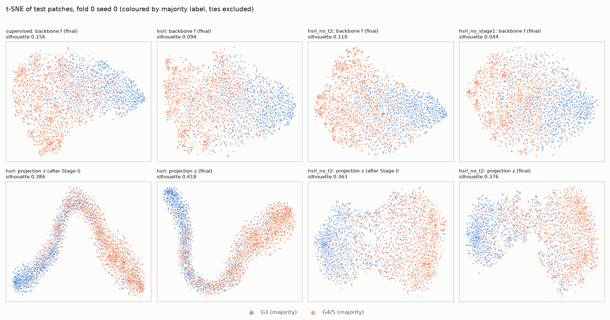
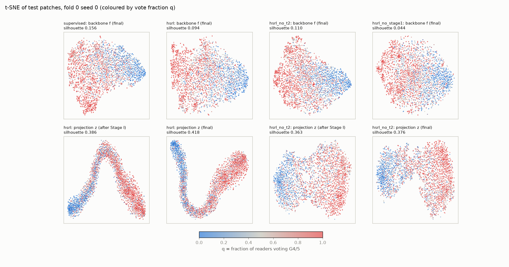
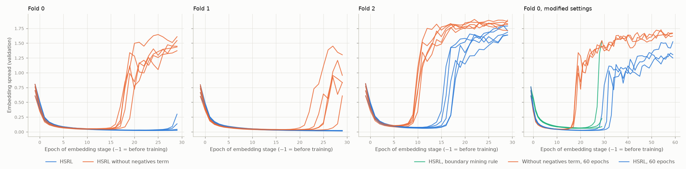
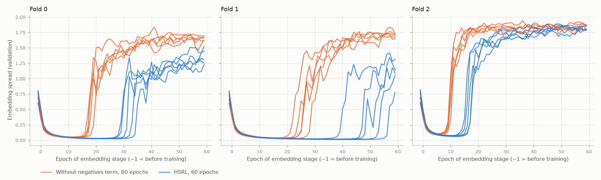
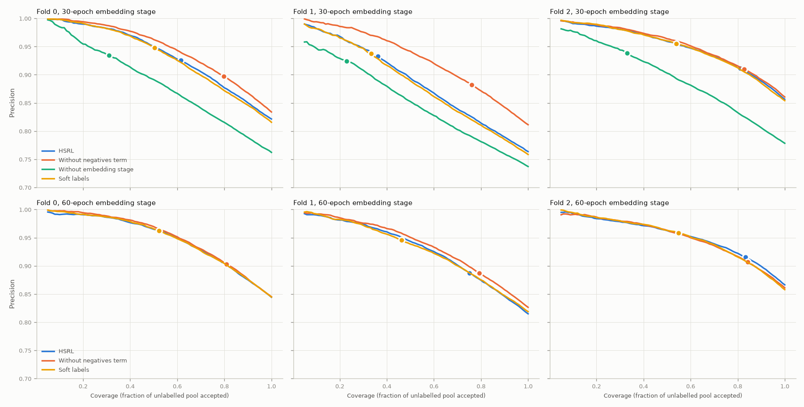

# HSRL on Gleason2019 and MHIST: main grid, deviation experiments and tuple census

Run 2026-10-20 to 25. 348 training runs (plus one reproducibility check), and 510 frozen-feature pilot runs, all
completed. Batch 2 (§5) added 2026-10-21; batch 3 (§6 soft-label baselines, §7 pseudo-label precision vs coverage)
added 2026-10-22; batch 4 (§8 Map1-bias test) added 2026-10-23. The overnight batch (§9 exploratory interval-loss
pilot, §10 Map4 reader swap, §11 1024 px tiles) was added 2026-10-25. Code, configs and every choice not fixed by the
paper: [ASSUMPTIONS.md](../ASSUMPTIONS.md) (decisions D1–D38, choices A1–A7). Batch-4 tables:
[excl_r1_summary/class_shift.md](excl_r1_summary/class_shift.md), [excl_r1_summary/report.md](excl_r1_summary/report.md).
Overnight tables: [pilot_frozen/report.md](pilot_frozen/report.md), [pilot_frozen_robust/report.md](pilot_frozen_robust/report.md),
[pilot_frozen_excl_r1/report.md](pilot_frozen_excl_r1/report.md), [reader_swap_summary/class_shift.md](reader_swap_summary/class_shift.md),
[p1024_summary/report.md](p1024_summary/report.md).
Detailed tables: [main_summary/report.md](main_summary/report.md), [deviations_summary/report.md](deviations_summary/report.md),
[census_summary/report.md](census_summary/report.md), [budget_summary/report.md](budget_summary/report.md),
[census_summary_s1e60/report.md](census_summary_s1e60/report.md), [soft_summary/report.md](soft_summary/report.md),
[pseudo_coverage/report.md](pseudo_coverage/report.md).

## Setup in brief
- **Data.** Gleason2019 training cores, p512 tiles resized to 224 px, label set `labels_benign-drop`.
  Binary task: G3 vs G4/5. A patch is kept if >= 3 pathologists give a valid G3/G4/5 label.
- **Folds.** 3 folds grouped by slide; test slides are {001,003}, {002,005}, {006,007}.
- **Labelled set.** 10% of each fold's training patches (~490 patches). Stage III uses the vote-filtered unlabelled pool
  (~4,500 patches), the same for every method.
- **Configs.** Supervised-only; HSRL original (Eq. 5, α=1, β=0.5, γ=0.5, 30 / 5 / 10 epochs, τ=0.85); HSRL without term 2;
  HSRL without Stage I (paper Table 4 ablation). 5 seeds × 3 folds each, so 15 runs per config.
- **Seeds.** Seeds vary initialisation, sampling, augmentation and mining. The labelled subset is fixed per fold.
- **Metrics.** Test metrics on non-tie patches. "Unanimous" = all readers agree; "split" = the readers disagree.
- **Statistical caveat.** The 15 runs per config share only 3 test-slide sets. Per-fold results and "folds agreeing in
  sign" are the conservative view; the t-intervals over 15 pairs are optimistic.

---

## 1. Main results (paper protocol)

### 1.1 Final test metrics, mean ± std over 15 runs

| config | acc | bal acc | macro F1 | AUROC | Brier ↓ | acc unanimous | acc split |
|---|---|---|---|---|---|---|---|
| Supervised-only | 0.793 ± 0.021 | 0.781 ± 0.026 | 0.779 ± 0.022 | 0.865 ± 0.022 | 0.171 ± 0.019 | 0.846 ± 0.020 | **0.662 ± 0.028** |
| HSRL original | 0.795 ± 0.014 | 0.773 ± 0.022 | 0.777 ± 0.018 | 0.870 ± 0.013 | 0.160 ± 0.019 | 0.853 ± 0.014 | 0.652 ± 0.026 |
| HSRL without term 2 | **0.802 ± 0.024** | **0.782 ± 0.026** | **0.786 ± 0.024** | **0.876 ± 0.021** | **0.158 ± 0.021** | **0.861 ± 0.021** | 0.656 ± 0.028 |
| HSRL without Stage I | 0.768 ± 0.020 | 0.747 ± 0.029 | 0.747 ± 0.025 | 0.844 ± 0.011 | 0.165 ± 0.015 | 0.823 ± 0.022 | 0.632 ± 0.034 |

Per fold (mean ± std over 5 seeds):

| config | fold 0 acc / bal acc | fold 1 acc / bal acc | fold 2 acc / bal acc |
|---|---|---|---|
| Supervised-only | 0.784 / 0.761 | 0.820 / 0.814 | 0.775 / 0.768 |
| HSRL original | 0.787 / 0.749 | 0.813 / 0.794 | 0.786 / 0.777 |
| HSRL without term 2 | 0.790 / 0.763 | 0.833 / 0.816 | 0.784 / 0.767 |
| HSRL without Stage I | 0.764 / 0.718 | 0.792 / 0.778 | 0.749 / 0.744 |

Differences between folds (up to 4.9 accuracy points for one config) are larger than any difference between methods.
Within a fold, the seed-to-seed std is 0.2–1.2 points for accuracy and 0.6–2.6 points for balanced accuracy.

### 1.2 Paired differences (same fold and seed; 15 pairs)

| comparison | Δ acc | Δ bal acc | Δ AUROC | Δ Brier | Δ acc split | consistent across folds? |
|---|---|---|---|---|---|---|
| HSRL − supervised | +0.002 [−0.004, 0.008] | −0.007 [−0.017, 0.002] | +0.006 [−0.003, 0.014] | **−0.011 [−0.016, −0.007]** | −0.010 [−0.022, 0.002] | only Brier (better in 15/15 pairs, 3/3 folds) |
| HSRL − without term 2 | −0.007 [−0.015, 0.000] | −0.009 [−0.020, 0.002] | −0.006 [−0.014, 0.002] | +0.002 | −0.004 | no (fold 2 reverses) |
| HSRL − without Stage I | **+0.027 [0.021, 0.033]** | **+0.026 [0.018, 0.035]** | **+0.026 [0.021, 0.031]** | −0.005 | **+0.020 [0.009, 0.031]** | yes: 15/15 pairs, 3/3 folds |
| without term 2 − supervised | **+0.009 [0.004, 0.015]** | +0.001 [−0.005, 0.008] | **+0.012 [0.006, 0.017]** | **−0.013 [−0.018, −0.008]** | −0.006 | acc, AUROC, Brier: 3/3 folds |
| without Stage I − supervised | **−0.025** | **−0.034** | **−0.021** | −0.006 | **−0.030** | yes, 3/3 folds |

Brackets are 95% t-intervals over the 15 pairs, which are optimistic. Bold = interval excludes 0.

**Reading.**
- **HSRL original does not beat supervised-only** on accuracy, balanced accuracy, AUROC or split-vote accuracy. Its only
  consistent gain is calibration (Brier −0.011).
- **Stage I matters inside HSRL.** Removing it costs about 2.7 points everywhere, as in the paper's ablation (paper: −5.0
  acc on MHIST). But "HSRL without Stage I" is not the supervised baseline: it trains a linear classifier on frozen
  ImageNet features. End-to-end supervised fine-tuning on the same 10% recovers all of that gap.
- **Removing term 2 does not hurt** and is slightly better on average. That is not consistent across folds, though: fold 2
  favours HSRL original, which is also the only fold where HSRL original escapes the collapse (§2).
- **Split-vote patches stay hard for every method.** Accuracy is about 0.65 on split-vote patches against about 0.85 on
  unanimous ones. No method narrows that gap.

### 1.3 Before vs after Stage III (paired within run, 15 runs per config)

| config | acc before → after | bal acc before → after | split-vote acc before → after | unanimous acc before → after |
|---|---|---|---|---|
| HSRL original | 0.775 → 0.795 (+0.020, 15/15 runs up) | 0.758 → 0.773 (+0.015) | 0.644 → 0.652 (+0.008, 8/15 up) | 0.828 → 0.853 (+0.025, 15/15) |
| HSRL without term 2 | 0.792 → 0.802 (+0.010) | 0.776 → 0.782 (+0.006) | 0.652 → 0.656 (+0.003, 9/15) | 0.848 → 0.861 (+0.013) |
| HSRL without Stage I | 0.742 → 0.768 (+0.026) | 0.717 → 0.747 (+0.030) | 0.600 → 0.632 (+0.033, 15/15) | 0.799 → 0.823 (+0.024) |

Stage III gives a consistent but small gain, and almost all of it is on unanimous patches. For HSRL original most of
the gain comes from fold 1 (+4.0 acc, against +0.8 on fold 0 and +1.2 on fold 2). The weaker the Stage II model, the
more Stage III helps. Values for every run: [main_summary/per_run_before_after_stage3.csv](main_summary/per_run_before_after_stage3.csv)
and the "Every run" table in [main_summary/report.md](main_summary/report.md).

### 1.4 Stage III pseudo-labels (τ = 0.85, checked against hidden majority labels)

| config | coverage | precision | precision, unanimous | precision, split |
|---|---|---|---|---|
| HSRL original | 0.596 ± 0.196 (fold 0: 0.62, fold 1: 0.36, fold 2: 0.81) | 0.923 ± 0.012 | 0.958 | 0.796 |
| HSRL without term 2 | 0.795 ± 0.032 | 0.897 ± 0.013 | 0.941 | 0.775 |
| HSRL without Stage I | 0.290 ± 0.049 | 0.932 ± 0.007 | 0.968 | 0.753 |

No run came near zero coverage (minimum 0.21, without Stage I on fold 1), and no flag was raised. Coverage and precision
trade off as expected. The coverage of HSRL original swings with the collapse state of Stage I: 0.49 when Stage I stays
collapsed against 0.81 when it escapes (§2).

### 1.5 t-SNE (fold 0, seed 0, test patches)

Silhouette (cosine, in the original space):
- **Backbone f:** supervised 0.156, HSRL 0.094, without term 2 0.110, without Stage I 0.044.
- **Projection z:** HSRL 0.386 after Stage I and 0.418 at the end; without term 2 0.363 and 0.376.

HSRL original's projection lies on an almost one-dimensional curve, ordered from G3 to G4/5. So the collapse (§2) is
dimensional as well as in scale. The run without term 2 escaped and forms two lobes. Split-vote patches (q near 0.5)
sit between the classes in every representation. The classes separate better in the projection space than in the
backbone, but the classifier uses the backbone.

---

## 2. Stage I collapse (paper protocol)

Spread = mean pairwise squared distance of the projection embeddings on a fixed 512-patch val subset. Before training it
is s0 ≈ 0.6–0.8.

| config | fold 0 | fold 1 | fold 2 |
|---|---|---|---|
| HSRL original | collapses; never rises in 30 epochs (0/5) | collapses; never rises (0/5) | shrinks to 0.09·s0, then rises at epochs 16–18 (5/5) |
| HSRL without term 2 | collapses; rises at epochs 17–20 (5/5) | collapses; rises at epochs 22–29 (5/5) | shrinks to 0.13·s0, then rises at epoch 10 (5/5) |

"Rises" = spread exceeds 0.5·s0 after its minimum. Note on the fold-2 numbers without term 2: the minimum never fell below
the 0.1·s0 collapse threshold (A3.3). The aggregate tables therefore list those 5 runs as "not collapsed", but the curve
shape is the same.

- **While collapsed** (HSRL original, folds 0–1), all three hinges are active on 100% of tuples in every epoch. The loss
  sits near its collapse value of α + β + γ = 2, and the norm of the mean embedding reaches about 0.99.
- **kNN accuracy keeps improving anyway** (k=5, on val): balanced accuracy goes from 0.60 to 0.82 ± 0.03 at the end. The
  class order survives inside the shrunken region of the sphere.
- **Escape is decided by the fold, not the seed.** All 5 seeds of a fold behave the same way, so the labelled set
  (~490 patches) and the backbone's starting geometry determine whether Stage I escapes. Removing term 2 makes escape
  earlier and universal.
- **Hypothesis, not tested:** in a binary task, n and c belong to the same class. Term 2 (d_nc > d_ap + β) then asks
  same-class pairs to be far apart, while terms 1 and 3 (through d_ap) ask same-class pairs to be close.
- **Effect on results.** On the escaped fold 2, HSRL original's pseudo-label coverage is 0.81, against 0.36–0.62 on the
  collapsed folds. That fold is also the only one where HSRL original beats the run without term 2.

---

## 3. Deviation experiments: NOT the paper's protocol

Fold 0, seeds 0–2, saved in `results/deviations/`. Each is compared with the matching fold-0 main runs (same seeds).

| config | escape (spread > 0.5·s0) | acc | bal acc | AUROC | acc split | coverage / precision |
|---|---|---|---|---|---|---|
| HSRL original, 30 ep (main) | 0/3 | 0.788 ± 0.006 | 0.751 ± 0.007 | 0.857 | 0.624 | 0.62 / 0.926 |
| **(a) HSRL original, Stage I 60 ep** | **3/3, epochs 30, 34, 32** | **0.799 ± 0.004** | **0.778 ± 0.011** | **0.866** | **0.653** | 0.80 / 0.902 |
| without term 2, 30 ep (main) | 3/3, epoch 18 | 0.787 ± 0.006 | 0.763 ± 0.009 | 0.856 | 0.639 | 0.79 / 0.899 |
| (b) without term 2, Stage I 60 ep | 3/3, epoch 18 | 0.792 ± 0.005 | 0.758 ± 0.008 | 0.861 | 0.626 | 0.81 / 0.904 |
| (c) HSRL original, boundary c-rule, 30 ep | 1/3 (epoch 27) | 0.792 ± 0.018 | 0.758 ± 0.027 | 0.858 | 0.628 | 0.61 / 0.927 |

Paired differences, 3 pairs each:
- (a) − 30-epoch HSRL: acc +0.011, bal acc +0.027 (3/3 seeds), split acc +0.029 (2/3).
- (a) − (b): bal acc +0.021 (3/3), acc +0.007 (3/3).
- (b) − 30-epoch without term 2: within ±0.006 everywhere.
- (c) − 30-epoch HSRL: about +0.005, high variance (1/3 seeds better).

**Reading.**
- **(a) Yes, HSRL original escapes when given more epochs:** at epochs 30–34, about 14 epochs later than the run without
  term 2. After escaping, the hinges mostly switch off. Final active fractions: term 1 0.07, term 2 0.60, term 3 0.02.
- **The 60-epoch HSRL original is the best fold-0 configuration** in this study: bal acc 0.778 against supervised-only's
  0.763 on the same seeds. It is also the only setting where term 2 appears to help (+2.1 bal acc over its matched control).
  This is 3 seeds on one fold, so treat it as a lead for the multi-fold check, not a result.
  **Superseded by §5:** with 5 seeds on all 3 folds, the term-2 advantage disappears (+0.003 bal acc). Against the
  budget-matched supervised control the gain is +0.003 bal acc and +0.009 acc.
- **(b) Extra epochs change nothing** for the run without term 2, which has already escaped by epoch 18.
- **(c) The boundary c-rule** delays the collapse slightly (minimum spread 0.063 against 0.025) and escapes in 1 of 3 seeds.
  It has no consistent effect on results.

---

## 4. Tuple census (HSRL original, all 3 folds × 5 seeds)

The linked verdict uses each reader's identity across patches; pairs with fewer than 3 shared readers are skipped.
The counts-only verdict uses only q and assumes a common reader panel, which Gleason does not strictly have.

### 4.1 Do HSRL's implied orderings hold in the annotations?

Mined tuples at epoch 29 (mean over 15 runs; random tuple set A gives the same pattern per fold):

| term | ordering | counts-only: certified / contradicted / undecided | linked: supported / violated / tie | skipped (< 3 shared readers) |
|---|---|---|---|---|
| 1 | s_ap > s_an | 95.0 / 0.0 / 5.0% | 94.8 / 1.6 / 3.6% | 25.5% |
| 2 | s_ap > s_nc | 34.9 / 26.4 / 38.7% | 36.7 / 28.4 / 35.0% | 28.8% |
| 3 | s_ap > s_ac | 95.2 / 0.0 / 4.8% | 95.2 / 1.8 / 3.0% | 25.5% |

- **Terms 1 and 3 match the annotations** in about 95% of tuples.
- **Term 2's ordering is violated in about 28% of tuples and a tie in about 35%.** n and c share a majority class, so the
  readers give no basis for s_ap > s_nc. While Stage I is collapsed, every tuple's hinge is active, so all of these
  tuples produce gradient.
- **Counts-only vs linked agree well.** Certified orderings are linked-violated in only 0.3–1.1% of tuples; contradicted
  ones are linked-violated in 75–84%. So the common-panel caveat costs little here.
- **Of counts-only "undecided" tuples, 13–28% turn out linked-violated** (varies by fold and term).
- **Mined tuples look like random ones** (set A vs set B), so the embedding-based mining does not seek out
  annotation-violating tuples.

### 4.2 Are wrong-but-confident pseudo-labels concentrated near violated or undecided tuples?

**Core level (primary).** For each core: the pseudo-label error rate, against the mean violation (or counts-undecided)
rate of that core's labelled patches. Spearman correlation over cores with >= 5 accepted patches; 15 runs, 74–118 cores each.

| tuple status | raw ρ (runs with p < 0.05) | partial ρ, controlling for the core's split-vote share (runs with p < 0.05) |
|---|---|---|
| linked-violated rate | 0.17 ± 0.10 (6/15); fold 0 0.24, fold 1 0.18, fold 2 0.08 | −0.04 ± 0.10 (0/15) |
| counts-undecided rate | 0.35 ± 0.11 (14/15); fold 0 0.23, fold 1 0.45, fold 2 0.37 | 0.06 ± 0.06 (0/15) |

**Patch level (secondary).** AUROC of the 5 nearest labelled neighbours' violation rate for predicting a wrong pseudo-label:
0.61 ± 0.03 overall, 0.66 within unanimous patches, 0.47 within split-vote patches. For the undecided rate: 0.59 / 0.64 / 0.48.
Pseudo-label error rate: 4.2% on unanimous patches vs 20.4% on split-vote patches.

**Answer: no independent concentration.** Pseudo-label errors do cluster in cores whose labelled patches sit in
violated or undecided tuples, especially undecided ones. But in all 15 runs that association disappears once the core's
share of split-vote patches is controlled for. Both quantities reflect how ambiguous a core is to its readers; the tuple
verdicts add no explanatory power beyond that. At patch level the neighbour signal only appears among unanimous patches,
and is absent or reversed among split-vote patches.

---

## 5. Batch 2: 30-epoch protocol vs 60-epoch Stage I and a budget-matched supervised control (DEVIATIONS)

**Everything in this section except the 30-epoch rows is a deviation from the paper's protocol** (D22–D24).
- **60-epoch HSRL runs:** Stage I 60 epochs instead of 30; Stage II 5 epochs and Stage III 10 epochs are unchanged.
- **Budget-matched control (`supervised_e65`):** supervised-only for 65 epochs (60 + 5), at the same lr 1e-4.
- **Coverage:** 5 seeds × 3 folds per config, paired with the 30-epoch runs on the same (fold, seed).
- **Reproducibility check:** the 60-epoch HSRL runs reproduce the 30-epoch runs' tuple logs exactly at epochs 0 and 29
  (identical census tables). Training is deterministic, so differences come only from the extra epochs.

### 5.1 Side by side: final test metrics, mean ± std over 15 runs

| config | protocol | acc | bal acc | AUROC | Brier ↓ | acc unanimous | acc split |
|---|---|---|---|---|---|---|---|
| Supervised-only, 35 ep | paper-matched baseline | 0.793 ± 0.021 | 0.781 ± 0.026 | 0.865 ± 0.022 | 0.171 ± 0.019 | 0.846 | 0.662 |
| Supervised-only, 65 ep | **deviation** (budget control) | 0.795 ± 0.020 | 0.786 ± 0.023 | 0.869 ± 0.023 | 0.171 ± 0.019 | 0.847 | **0.665** |
| HSRL original, Stage I 30 ep | paper | 0.795 ± 0.014 | 0.773 ± 0.022 | 0.870 ± 0.013 | 0.160 ± 0.019 | 0.853 | 0.652 |
| HSRL original, Stage I 60 ep | **deviation** | **0.804 ± 0.018** | **0.789 ± 0.024** | 0.878 ± 0.021 | 0.160 ± 0.018 | 0.862 | 0.661 |
| HSRL without term 2, Stage I 30 ep | paper ablation | 0.802 ± 0.024 | 0.782 ± 0.026 | 0.876 ± 0.021 | **0.158 ± 0.021** | 0.861 | 0.656 |
| HSRL without term 2, Stage I 60 ep | **deviation** | **0.804 ± 0.022** | 0.786 ± 0.031 | **0.879 ± 0.022** | 0.160 ± 0.019 | 0.862 | 0.659 |

Balanced accuracy per fold (mean over 5 seeds):

| config | fold 0 | fold 1 | fold 2 |
|---|---|---|---|
| Supervised-only, 35 / 65 ep | 0.761 / 0.764 | 0.814 / 0.816 | 0.768 / 0.777 |
| HSRL original, 30 / 60 ep | 0.749 / 0.769 | 0.794 / 0.819 | 0.777 / 0.779 |
| HSRL without term 2, 30 / 60 ep | 0.763 / 0.759 | 0.816 / 0.825 | 0.767 / 0.773 |

### 5.2 Paired differences (same fold and seed, 15 pairs; 95% t-interval, optimistic, see setup)

| comparison | Δ acc | Δ bal acc | Δ AUROC | Δ Brier | Δ acc split | pairs better (bal acc) | folds agreeing in sign (bal acc) |
|---|---|---|---|---|---|---|---|
| HSRL original: 60 − 30 ep | **+0.009 [0.005, 0.013]** | **+0.016 [0.006, 0.025]** | +0.008 [0.000, 0.016] | −0.000 | +0.008 [−0.005, 0.022] | 13/15 | 3/3 (f0 +0.020, f1 +0.025, f2 +0.002) |
| without term 2: 60 − 30 ep | +0.001 | +0.004 [−0.005, 0.012] | +0.003 | +0.001 | +0.003 | 8/15 | 2/3 |
| Supervised: 65 − 35 ep | +0.002 | +0.005 [−0.001, 0.011] | +0.004 | −0.000 | +0.003 | 10/15 | 3/3 |
| **HSRL 60 ep − supervised 65 ep (fair budget)** | **+0.009 [0.003, 0.016]** | +0.003 [−0.004, 0.010] | **+0.009 [0.003, 0.015]** | **−0.011 [−0.016, −0.007]** | −0.005 [−0.019, 0.010] | 8/15 | 3/3, but each fold under +0.006 |
| without term 2 60 ep − supervised 65 ep | **+0.009 [0.003, 0.015]** | +0.000 [−0.008, 0.008] | **+0.010 [0.006, 0.014]** | **−0.011 [−0.016, −0.007]** | −0.007 [−0.021, 0.007] | 8/15 | 1/3 |
| HSRL 60 ep − without term 2 60 ep | +0.001 [−0.006, 0.007] | +0.003 [−0.005, 0.012] | −0.001 | +0.000 | +0.002 | 8/15 | 2/3 (f0 +0.010, f1 −0.007, f2 +0.006) |

Bold = interval excludes 0. For accuracy, AUROC and Brier, both 60-epoch HSRL variants beat the budget-matched control
on all 3 folds.

### 5.3 Collapse and escape with 60 Stage I epochs

| config | fold 0 | fold 1 | fold 2 | final spread | final kNN-5 bal acc (val) |
|---|---|---|---|---|---|
| HSRL original, 60 ep | escapes 5/5, epochs 30–35 | escapes 5/5, epochs 40–57 | escapes 5/5, epochs 16–18 | 1.41 ± 0.34 | 0.833 ± 0.033 |
| without term 2, 60 ep | escapes 5/5, epochs 17–20 | escapes 5/5, epochs 22–29 | rises at epoch 10 (5/5) | 1.73 ± 0.09 | 0.843 ± 0.013 |

- **With 60 epochs every HSRL-original run escapes**, but always later than its without-term-2 counterpart: about 14
  epochs later on fold 0 (range 12–16), 24 on fold 1 (18–28) and 7 on fold 2 (6–8), in paired seeds.
- **On fold 1 the escape is late.** One seed escapes at epoch 57, so it trains only 3 epochs after leaving the collapsed
  state. A 60-epoch budget is borderline there.
- **After escape most hinges switch off.** Final active fractions for HSRL original at 60 epochs: term 1 0.18, term 2 0.49,
  term 3 0.07. Term 2 stays the most active, consistent with it opposing same-class compactness.

### 5.4 Before vs after Stage III, 60-epoch runs (paired within run)

| config | acc before → after | bal acc before → after | split acc Δ | unanimous acc Δ |
|---|---|---|---|---|
| HSRL original, 60 ep | +0.011 (15/15 runs up) | +0.005 (11/15) | −0.001 (6/15 up) | +0.016 (15/15) |
| without term 2, 60 ep | +0.009 (13/15) | +0.004 (10/15) | −0.001 (3/15 up) | +0.013 (13/15) |

For comparison, at 30 epochs HSRL original gained +0.020 acc from Stage III. Once Stage I has escaped, the Stage II model
is better and Stage III adds less. As at 30 epochs, Stage III helps unanimous patches and leaves split-vote accuracy
unchanged. Values for every run: the "Every run" table in [budget_summary/report.md](budget_summary/report.md).

### 5.5 Pseudo-labels with 60 epochs

| config | coverage | precision | precision unanimous | precision split |
|---|---|---|---|---|
| HSRL original, 30 ep | 0.596 ± 0.196 | 0.923 | 0.958 | 0.796 |
| HSRL original, 60 ep | 0.796 ± 0.043 | 0.902 | 0.942 | 0.796 |
| without term 2, 60 ep | 0.815 ± 0.024 | 0.899 | 0.941 | 0.788 |

After escape, coverage rises to about 0.80 and becomes stable across folds. Precision drops by about 2 points, which is the
expected trade-off at a fixed τ.

### 5.6 Census on the 60-epoch HSRL runs ([census_summary_s1e60/report.md](census_summary_s1e60/report.md))

- **Orderings:** unchanged from §4.1 at every logged epoch (0, 29, 59). Terms 1 and 3 are linked-supported in about 95%
  of tuples. At epoch 59, term 2 is 29.0% violated and 33.8% tie.
- **Core level (primary).** Violation rate: raw ρ = 0.22 ± 0.11 (8/15 runs p < 0.05); partial ρ controlling for split-vote
  share = 0.03 ± 0.11 (0/15). Counts-undecided rate: raw ρ = 0.42 ± 0.09 (15/15); partial ρ = 0.14 ± 0.11 (**5/15**,
  mainly fold 1, partial ρ 0.25 ± 0.08).
- **Patch level (secondary).** Neighbour violation-rate AUROC 0.56 ± 0.04 (unanimous 0.61, split-vote 0.45);
  undecided-rate AUROC 0.61 ± 0.03.
- **Reading.** As at 30 epochs, linked violations add nothing beyond core ambiguity. For counts-undecided tuples a weak
  residual association appears in a third of the runs, mostly on fold 1, where Stage I escapes latest. This is an
  observation, not a robust effect.

### 5.7 Reading of batch 2
1. **Longer Stage I helps HSRL original** (+1.6 bal acc, +0.9 acc, consistent in sign on all folds) **because it lets the
   collapse escape.** It does not help the variant without term 2, which already escapes within 30 epochs. A longer
   supervised schedule also barely changes supervised-only (+0.5 bal acc).
2. **At a matched budget, HSRL is not better on balanced accuracy** (+0.003, interval includes 0, under 0.6 points on every
   fold). It is consistently but modestly better on accuracy (+0.9) and AUROC (+0.9), and clearly better calibrated
   (Brier −0.011, all folds). Split-vote accuracy is no better (−0.5).
3. **Term 2 makes no measurable difference once both variants have escaped** (60 vs 60: +0.3 bal acc, folds disagree in
   sign). Its main observable effect is delaying escape. The fold-0 three-seed lead in §3 did not survive more seeds and folds.

---

## 6. Batch 3: soft-label baselines (supervisor's plan §7)

All configs are 5 seeds × 3 folds, in `results/soft/` (D25).
- **Soft targets** are (1 − q, q), computed from the linked votes of labelled training patches only.
- **Same labelled patches** as the hard-target runs: ties stay excluded (A5.1). So soft and hard runs differ only in the target.
- **Peterson-style:** supervised-only with soft targets, no structural training.
- **HSRL soft:** soft targets in Stage II only, with majority-label tuples in Stage I. Stage III is unchanged: hard labelled
  targets plus hard pseudo-labels.
- **Stage I reuse:** the HSRL soft runs reuse the Stage I checkpoint of the hard-target run with the same fold, seed and
  schedule. Stage I is therefore identical, and each soft–hard pair differs only from Stage II on. The check: re-running a
  hard-target run from its own checkpoint reproduced every prediction exactly (A5.3).
- **Labels:** the 35-epoch supervised and 30-epoch HSRL hard rows are the paper-protocol baselines. All 65-epoch and
  60-epoch rows are **deviations** (D22–D23). Soft targets in HSRL are themselves a change to the paper.

### 6.1 Final test metrics, mean ± std over 15 runs

| config | budget | acc | bal acc | AUROC | Brier ↓ | acc unanimous | acc split |
|---|---|---|---|---|---|---|---|
| Supervised, hard | 35 ep | 0.793 ± 0.021 | 0.781 ± 0.026 | 0.865 ± 0.022 | 0.171 ± 0.019 | 0.846 | 0.662 |
| **Supervised, soft (Peterson)** | 35 ep | 0.799 ± 0.023 | 0.781 ± 0.026 | 0.873 ± 0.020 | **0.142 ± 0.016** | 0.857 | 0.655 |
| Supervised, hard | 65 ep (dev.) | 0.795 ± 0.020 | 0.786 ± 0.023 | 0.869 ± 0.023 | 0.171 ± 0.019 | 0.847 | **0.665** |
| **Supervised, soft (Peterson)** | 65 ep (dev.) | 0.799 ± 0.024 | 0.786 ± 0.027 | 0.872 ± 0.021 | **0.142 ± 0.015** | 0.857 | 0.656 |
| HSRL, hard Stage II | 30 ep | 0.795 ± 0.014 | 0.773 ± 0.022 | 0.870 ± 0.013 | 0.160 ± 0.019 | 0.853 | 0.652 |
| HSRL, soft Stage II | 30 ep | 0.794 ± 0.016 | 0.762 ± 0.024 | 0.870 ± 0.011 | 0.158 ± 0.018 | 0.858 | 0.635 |
| HSRL, hard Stage II | 60 ep (dev.) | 0.804 ± 0.018 | **0.789 ± 0.024** | **0.878 ± 0.021** | 0.160 ± 0.018 | 0.862 | 0.661 |
| HSRL, soft Stage II | 60 ep (dev.) | **0.807 ± 0.021** | 0.780 ± 0.026 | 0.875 ± 0.021 | 0.156 ± 0.019 | **0.871** | 0.647 |

### 6.2 Paired differences vs the matching hard-target runs (same fold and seed, 15 pairs)

| comparison | Δ acc | Δ bal acc | Δ AUROC | Δ Brier | Δ acc split | consistent across folds? |
|---|---|---|---|---|---|---|
| Supervised soft − hard, 35 ep | **+0.006 [0.003, 0.010]** | +0.001 [−0.006, 0.007] | **+0.009 [0.002, 0.015]** | **−0.029 [−0.032, −0.026]** | −0.007 [−0.017, 0.002] | Brier 15/15 pairs, 3/3 folds; acc 3/3 folds |
| Supervised soft − hard, 65 ep | +0.004 [−0.002, 0.011] | +0.000 [−0.007, 0.007] | +0.003 | **−0.029 [−0.033, −0.024]** | −0.010 [−0.020, 0.001] | Brier 15/15, 3/3 folds |
| HSRL soft − hard Stage II, 30 ep | −0.001 [−0.006, 0.004] | **−0.011 [−0.019, −0.003]** | −0.000 | −0.002 | **−0.017 [−0.031, −0.003]** | bal acc lower on 3/3 folds (2/15 pairs better) |
| HSRL soft − hard Stage II, 60 ep | +0.002 [−0.003, 0.008] | **−0.009 [−0.016, −0.002]** | −0.003 | −0.004 [−0.008, 0.000] | −0.014 [−0.028, 0.000] | bal acc lower on 3/3 folds (3/15 better) |

Same comparison measured right after Stage II, before Stage III, which is where the soft targets act:

| comparison (Stage II model) | Δ acc | Δ bal acc | Δ Brier | Δ acc split | Δ acc unanimous |
|---|---|---|---|---|---|
| HSRL soft − hard, 30 ep | +0.000 | **−0.013 [−0.016, −0.009]** (0/15 better) | **−0.010 [−0.017, −0.004]** | **−0.023 [−0.033, −0.013]** (0/15) | **+0.009 [0.004, 0.014]** |
| HSRL soft − hard, 60 ep | +0.003 | **−0.010 [−0.016, −0.004]** | **−0.021 [−0.024, −0.018]** (15/15) | **−0.020 [−0.031, −0.009]** | **+0.013 [0.008, 0.017]** |

Method comparison under soft targets:
- **HSRL soft 30 ep − Peterson 35 ep:** bal acc −0.019 [−0.031, −0.007], Brier +0.016 (worse), split acc −0.020. All 3 folds agree.
- **HSRL soft 60 ep − Peterson 65 ep:** acc +0.007 [0.002, 0.013] (13/15, 3/3 folds), bal acc −0.006 [−0.013, 0.001],
  Brier +0.014 (worse in 15/15).

### 6.3 Why soft targets lower balanced accuracy: a shift toward G4/5

Per-class recall on test (non-tie; true G4/5 rate 0.624). HSRL rows are the Stage II model; supervised rows are final.

| config | predicted G4/5 rate | G3 recall | G4/5 recall |
|---|---|---|---|
| Supervised hard / soft (35 ep) | 0.621 / 0.643 | 0.730 / 0.709 | 0.832 / 0.854 |
| HSRL hard / soft, 30 ep | 0.632 / **0.682** | 0.690 / **0.625** | 0.826 / 0.866 |
| HSRL hard / soft, 60 ep | 0.609 / **0.661** | 0.747 / **0.682** | 0.822 / 0.867 |

The cause is in the labelled soft targets. In every fold, 43–56% of labelled G3-majority patches carry at least one G4/5
vote (mean q 0.12–0.15), and **68–75% of those minority G4/5 votes come from Map1**, the reader who grades higher (Phase 0
and Phase 1). G4/5-majority patches are much cleaner: mean 1 − q is 0.04–0.07, and only 14–16% of their minority votes
come from Map1. So soft targets pull G3 patches toward G4/5 far more than the reverse, mostly carrying one reader's
grading bias. The shift is stronger with HSRL's frozen-backbone linear warm-up than with end-to-end supervised training.
This is supported by the vote counts. **It is tested directly in §8**: with Map1 excluded, the shift disappears.

### 6.4 Stage III and pseudo-labels with soft Stage II targets

| config | Stage III Δ acc | Stage III Δ split acc | τ = 0.85 coverage | precision | precision unanimous / split |
|---|---|---|---|---|---|
| HSRL hard, 30 ep | +0.020 | +0.008 (8/15 up) | 0.596 ± 0.196 | 0.923 | 0.958 / 0.796 |
| HSRL soft, 30 ep | +0.019 | **+0.014 (12/15 up)** | **0.459 ± 0.098** | **0.947** | 0.976 / 0.809 |
| HSRL hard, 60 ep | +0.011 | −0.001 (6/15) | 0.796 ± 0.043 | 0.902 | 0.942 / 0.796 |
| HSRL soft, 60 ep | +0.010 | +0.006 (8/15) | **0.511 ± 0.042** | **0.955** | 0.981 / 0.838 |

Soft Stage II targets make the classifier less confident, so at a fixed τ it accepts fewer pseudo-labels, and those it
accepts are more precise. §7 shows that this precision gain comes entirely from lower coverage. Stage III recovers part
of the split-vote loss, but final split-vote accuracy stays below the hard-target runs (§6.2).

### 6.5 Reading
1. **Peterson-style soft labels mainly improve calibration.** Brier −0.029 in 15 of 15 pairs at both budgets is the
   largest and most consistent effect in this study. Accuracy and AUROC improve slightly at 35 epochs (+0.006, +0.009).
   Balanced accuracy and split-vote accuracy do not improve. The best-calibrated model overall is supervised soft
   (Brier 0.142), better than any HSRL variant (≥ 0.156).
2. **Soft Stage II targets do not help HSRL.** Balanced accuracy drops by about 1 point at both schedules, consistent on
   all folds, because predictions shift toward G4/5 (§6.3). Accuracy is unchanged. Calibration improves after Stage II but
   mostly washes out after Stage III, which uses hard targets.
3. **Split-vote patches get worse, not better, with soft targets** (−0.7 to −2.3 points), in both supervised and HSRL.
   On this data, the information in vote fractions does not translate into better decisions on ambiguous patches.

---

## 7. Pseudo-label precision at equal coverage and coverage at equal precision (all runs, no retraining)

From each run's saved Stage III file: the Stage II model's confidence on every patch of the unlabelled pool (A5.4,
[pseudo_coverage/report.md](pseudo_coverage/report.md)). The pool is identical for every config within a fold, so
equal-coverage comparisons rank the same patches. Supervised-only runs have no Stage III and are not included.

### 7.1 Mean ± std over 15 runs per config

| config | precision @ 50% coverage | precision @ 80% coverage | coverage @ 93% precision | coverage @ 95% precision | split-vote share @ 50% coverage | actual τ = 0.85 point (coverage / precision) |
|---|---|---|---|---|---|---|
| HSRL original, 30 ep | 0.934 ± 0.031 | 0.868 ± 0.043 | 0.561 ± 0.150 | 0.457 ± 0.134 | 0.206 | 0.596 / 0.923 |
| without term 2, 30 ep | 0.956 ± 0.011 | 0.895 ± 0.019 | 0.647 ± 0.076 | 0.544 ± 0.069 | 0.200 | 0.795 / 0.897 |
| without Stage I | 0.882 ± 0.023 | 0.810 ± 0.023 | 0.300 ± 0.080 | 0.206 ± 0.074 | 0.226 | 0.290 / 0.932 |
| HSRL soft Stage II, 30 ep | 0.932 ± 0.033 | 0.865 ± 0.045 | 0.548 ± 0.155 | 0.453 ± 0.133 | 0.189 | 0.459 / 0.947 |
| HSRL original, 60 ep (dev.) | 0.957 ± 0.011 | 0.900 ± 0.021 | 0.678 ± 0.081 | 0.560 ± 0.072 | 0.207 | 0.796 / 0.902 |
| without term 2, 60 ep (dev.) | **0.961 ± 0.009** | **0.903 ± 0.014** | **0.681 ± 0.055** | **0.571 ± 0.052** | 0.204 | 0.815 / 0.899 |
| HSRL soft Stage II, 60 ep (dev.) | 0.956 ± 0.013 | 0.898 ± 0.018 | 0.662 ± 0.078 | 0.548 ± 0.082 | 0.177 | 0.511 / 0.955 |

The boundary c-rule (fold 0, 3 seeds) is within ±0.01 of HSRL original on fold 0 for every measure.

### 7.2 Paired differences (same fold and seed, 15 pairs)

| comparison | Δ precision @ 50% cov | Δ precision @ 80% cov | Δ coverage @ 93% prec | Δ split share @ 50% cov | consistent across folds? |
|---|---|---|---|---|---|
| without term 2 − HSRL, 30 ep | **+0.022 [0.010, 0.033]** | **+0.026 [0.012, 0.041]** | **+0.086 [0.042, 0.130]** | −0.006 | 3/3 folds (fold 1 largest: +0.048 / +0.18) |
| without Stage I − HSRL, 30 ep | **−0.052 [−0.060, −0.045]** | **−0.058** | **−0.262** | +0.020 | 3/3, 0/15 pairs higher |
| HSRL 60 ep − 30 ep | **+0.023 [0.010, 0.035]** | **+0.032 [0.019, 0.045]** (15/15) | **+0.117 [0.077, 0.157]** (15/15) | +0.001 | 3/3 |
| without term 2 − HSRL, 60 ep | +0.004 [0.000, 0.008] | +0.002 | +0.003 | −0.003 | 2/3 |
| HSRL soft − hard Stage II, 30 ep | −0.002 [−0.004, −0.000] | −0.003 | **−0.013 [−0.022, −0.004]** | **−0.017 [−0.026, −0.009]** (0/15 higher) | 3/3 |
| HSRL soft − hard Stage II, 60 ep | −0.001 | −0.002 | **−0.016 [−0.027, −0.005]** | **−0.030 [−0.039, −0.022]** (0/15 higher) | 3/3 |

### 7.3 Reading
1. **Comparisons at the fixed τ mislead**, as the supervisor's plan anticipated. At τ = 0.85, soft Stage II looks safer
   (precision 0.947 vs 0.923, 0.955 vs 0.902) but accepts much less of the pool (coverage 0.46 vs 0.60, 0.51 vs 0.80).
   At equal coverage its precision is the same or marginally lower. Likewise, without Stage I has the highest τ-point
   precision (0.932) only because it accepts 29% of the pool. At equal coverage it is the worst config by about 5 points.
2. **The genuine ranking improvements come from escaping the Stage I collapse.** Either removing term 2 (at 30 epochs)
   or training Stage I for 60 epochs raises precision at equal coverage by 2–3 points, and the coverage reachable at 93%
   precision by 9–12 points of the pool. Once both variants have escaped (60 vs 60), term 2 makes no difference. This
   matches §2 and §5.
3. **Soft targets change which patches are confident, not how many are right.** At equal coverage they accept fewer
   split-vote patches (−1.7 and −3.0 points of the accepted set), but overall precision does not improve.

---

## 8. Batch 4: does the soft-target shift toward G4/5 come from Map1? (test of §6.3)

All runs use the pre-built label set with Map1 excluded (`labels_benign-drop_excl-r1`), 5 seeds × 3 folds, in
`results/excl_r1/` (D28–D30):
- supervised hard and soft (Peterson), 35 epochs;
- HSRL with hard and with soft Stage II targets, Stage I 30 epochs. Each soft run reuses the Stage I of its hard pair (A5.3).

**Soft vs hard is compared only within this setting** (same fold and seed, 15 pairs). Against the with-Map1 runs only
the size of the soft − hard difference is compared, never raw metrics.

One run (`f0s3_hsrl`) crashed at 01:59 with a transient GPU-driver error (`CUDA error: unknown error` in the data
loader's pin-memory thread). Its paired soft run then failed for lack of a Stage I checkpoint. Both were redone from
scratch by the resumable queue. All 60 runs completed, so every comparison has 15 pairs.

### 8.1 What changes when Map1 is excluded

Excluding a reader changes which patches are kept, their majority labels and ties, the labelled subset, and the
val/test patches. Splits are redrawn by the same procedure on the same slide-grouped folds (A6.1).

| | with Map1 | Map1 excluded |
|---|---|---|
| kept patches (all folds) | 8,897 (G3 3,204 / G4/5 5,337 / tie 356) | 7,212 (G3 2,673 / G4/5 4,453 / tie 86) |
| unanimous patches | 68.6% | 81.6% |
| readers per kept patch | 3: 24%, 4: 51%, 5: 22%, 6: 3% | 3: 67%, 4: 28%, 5: 5% |
| labelled patches used, fold 0 / 1 / 2 | 488 / 470 / 509 | 415 / 386 / 420 |
| unlabelled pool, fold 0 / 1 / 2 | 4,548 / 4,409 / 4,781 | 3,786 / 3,511 / 3,834 |
| test patches, fold 0 / 1 / 2 | 3,004 / 3,186 / 2,707 | 2,305 / 2,664 / 2,243 |
| labelled G3 patches: mean q (share with any G4/5 vote) | 0.12–0.15 (43–56%) | 0.07–0.08 (24–26%) |
| labelled G4/5 patches: mean 1 − q (share with any G3 vote) | 0.04–0.07 (15–22%) | 0.03–0.06 (11–19%) |

Removing Map1 roughly halves the minority G4/5 votes on G3 patches, while the G4/5 side changes little. The soft targets
become much more symmetric.

### 8.2 Soft − hard, within each setting (paired, 15 pairs; 95% t-interval)

| comparison | metric | with Map1 | Map1 excluded |
|---|---|---|---|
| **HSRL, after Stage II** | predicted G4/5 rate | **+0.049 [+0.033, +0.065]** (15/15 pairs up) | −0.001 [−0.016, +0.015] (7/15) |
| | G3 recall | **−0.065 [−0.085, −0.045]** (0/15 up) | +0.001 [−0.020, +0.022] (8/15) |
| | G4/5 recall | **+0.040 [+0.026, +0.054]** | −0.001 [−0.013, +0.011] |
| | balanced accuracy | **−0.013 [−0.016, −0.009]** (0/15 up) | −0.000 [−0.006, +0.005] (8/15) |
| | Brier ↓ | **−0.010 [−0.017, −0.004]** | **−0.005 [−0.008, −0.002]** |
| | split-vote accuracy | **−0.023 [−0.033, −0.013]** (0/15 up) | −0.003 [−0.010, +0.005] |
| **HSRL, final (after Stage III)** | predicted G4/5 rate | **+0.039 [+0.020, +0.058]** | −0.008 [−0.026, +0.010] |
| | G3 recall | **−0.053 [−0.080, −0.026]** | +0.005 [−0.018, +0.027] |
| | balanced accuracy | **−0.011 [−0.019, −0.003]** | −0.003 [−0.007, +0.002] |
| | Brier ↓ | −0.002 [−0.005, +0.002] | +0.002 [−0.001, +0.005] |
| | split-vote accuracy | **−0.017 [−0.031, −0.003]** | −0.003 [−0.009, +0.003] |
| **Supervised, 35 ep (Peterson)** | predicted G4/5 rate | **+0.022 [+0.007, +0.037]** | −0.006 [−0.024, +0.012] |
| | G3 recall | −0.021 [−0.043, +0.000] | **+0.025 [+0.004, +0.046]** |
| | G4/5 recall | **+0.023 [+0.011, +0.034]** | +0.005 [−0.015, +0.024] |
| | balanced accuracy | +0.001 [−0.006, +0.007] | **+0.015 [+0.006, +0.023]** (14/15 up, 3/3 folds) |
| | Brier ↓ | **−0.029 [−0.032, −0.026]** | **−0.027 [−0.034, −0.020]** |
| | split-vote accuracy | −0.007 [−0.017, +0.002] | −0.002 [−0.012, +0.008] |

Bold = interval excludes 0. Per-run values, per-fold means and sign counts:
[excl_r1_summary/class_shift.md](excl_r1_summary/class_shift.md) and `class_shift_paired.csv`.

Raw values in the Map1-excluded setting, for completeness only. They are not comparable to the with-Map1 rows elsewhere
in this report:
- **Final bal acc:** supervised hard 0.762, soft 0.776; HSRL hard 0.767, soft 0.764.
- **Final Brier:** 0.179, 0.152, 0.160, 0.162 in the same order.
- **Stage I:** collapses in 15/15 HSRL runs and escapes in 6/15 by epoch 30.
- **Stage III pseudo-labels at τ:** coverage 0.55 (hard) vs 0.48 (soft), precision 0.923 vs 0.938.

### 8.3 Reading
1. **The shift toward G4/5 disappears when Map1 is excluded.** In HSRL after Stage II, the soft − hard change in
   predicted G4/5 rate goes from +0.049 to −0.001, and in G3 recall from −0.065 to +0.001. The balanced-accuracy cost
   (−0.013, 0/15 pairs better) and the split-vote cost (−0.023) also vanish. The same holds after Stage III.
2. **Soft targets still carry information without Map1, so the null shift isn't just an absence of soft signal.**
   Peterson-style training keeps almost all its calibration gain (Brier −0.027 vs −0.029). Without Map1 it now also
   improves balanced accuracy (+0.015, 14/15 pairs, all 3 folds) and G3 recall (+0.025). With Map1 it had neither.
3. **This supports the §6.3 explanation.** The shift was carried mainly by Map1's minority G4/5 votes on G3-majority
   patches. Two caveats:
   - Excluding Map1 also removes about half of all disagreement, and patches are left with fewer readers (3.4 vs 4.0
     per labelled patch). So the test cannot separate "Map1's bias" from "Map1 contributes most of the asymmetric
     disagreement".
   - Fold 0, the fold whose labelled set stays the most asymmetric without Map1, keeps a small residual shift
     (+0.029 predicted G4/5 after Stage II). That is consistent with the explanation, but it is one fold of three.
4. **For HSRL, soft Stage II targets are neutral without Map1** (bal acc −0.000, Brier −0.005). They no longer hurt,
   but they don't help either, unlike in end-to-end supervised training.

---

## 9. EXPLORATORY PILOT: interval losses on frozen ImageNet features (supervisor's plan, first test)

**This is an exploratory pilot, not part of the HSRL reproduction.** It tests the plan's question cheaply: do pairwise
reader relationships add anything beyond vote fractions? The design and success criterion were fixed before the main
run (D31–D35, A7.1–A7.6). One smoke run on fold 0, seed 0 was used only for timing; no setting changed afterwards.

Setup:
- **Features:** ImageNet EfficientNet-B2 features, cached once, so there is no HSRL training and no collapse.
- **Training:** on each fold's labelled patches only. A small head (1408 → 512 → 128) is trained per method.
- **Fixed tuples:** one fixed tuple set per (fold, seed), shared by every loss.
- **Evaluation:** a linear probe on hard majority targets, scored on test non-tie patches.
- **Interval losses:**
  - interval (feasibility) loss, plan §3;
  - independent worst-case loss, plan §4.
- **Vote modes, for both losses:**
  - linked: exact agreement among at least 3 shared pathologists, otherwise the counts bounds;
  - permuted: votes reassigned among each patch's readers;
  - counts_only: Fréchet bounds from q.
- **Same-feature baselines:**
  - linear probe, hard targets;
  - linear probe, soft targets;
  - head trained with HSRL terms 1 + 3;
  - annotator-aware classifier (one head per pathologist).

**Pre-registered success criterion:** at least +1 point on balanced or split-vote accuracy over the best baseline, in
at least 12 of 15 pairs and on at least 2 of 3 folds. "Linkage matters" = linked beats permuted by the same standard.

### 9.1 Results (15 fold–seed pairs)

| method | bal acc | split-vote acc | unanimous acc | Brier ↓ | retrieval ρ |
|---|---|---|---|---|---|
| Linear probe, hard | 0.702 ± 0.003 | **0.626** ± 0.013 | 0.729 | 0.267 | – |
| Linear probe, soft | 0.671 ± 0.014 | 0.586 ± 0.027 | 0.717 | 0.270 | – |
| Annotator-aware classifier | 0.720 ± 0.018 | 0.600 ± 0.026 | **0.807** | **0.188** | – |
| Head, HSRL terms 1 + 3 | 0.713 ± 0.017 | 0.600 ± 0.028 | 0.784 | 0.246 | 0.297 |
| Interval, linked | 0.724 ± 0.015 | 0.601 ± 0.017 | 0.802 | 0.241 | 0.306 |
| Interval, permuted | 0.724 ± 0.017 | 0.603 ± 0.023 | 0.801 | 0.242 | 0.313 |
| Interval, counts-only | 0.718 ± 0.020 | 0.593 ± 0.028 | 0.807 | 0.239 | 0.329 |
| Worst-case, linked | 0.725 ± 0.016 | 0.603 ± 0.018 | 0.801 | 0.239 | 0.315 |
| Worst-case, permuted | **0.726** ± 0.018 | 0.606 ± 0.023 | 0.801 | 0.240 | 0.321 |
| Worst-case, counts-only | 0.723 ± 0.015 | 0.605 ± 0.023 | 0.802 | 0.236 | **0.331** |

Retrieval ρ = Spearman correlation between embedding similarity and linked pathologist agreement on 20,000 held-out
test pairs (secondary).

**Pre-registered verdict: no method succeeds, and linkage does not matter.**
- **Against the best baseline for balanced accuracy** (the annotator-aware classifier): the interval losses gain only
  +0.003 to +0.006. At most 3 of 15 pairs reach +1 point, and no fold does.
- **Against the best baseline for split-vote accuracy** (the hard linear probe): every interval loss is 1.9–3.3 points
  worse.
- **Calibration:** every interval loss has a Brier score about 0.05 worse than the annotator-aware classifier.
- **Linked − permuted:** −0.001 balanced accuracy and −0.002 to −0.004 split-vote accuracy for both variants. Zero of
  15 pairs reach +1 point.

### 9.2 Robustness checks (secondary)
- **Five permutation draws:** linked − permuted stays between −0.002 and 0.000 balanced accuracy for every draw and for
  their mean. Never more than 1 of 15 pairs reaches +1 point.
- **Consistent reader renaming:** relabelling all pathologist IDs the same way changes the results by exactly 0.000 in
  all 15 pairs, as it must. This is a code sanity check.
- **Pilot with Map1 excluded** (its own label set and feature cache):
  - again no method succeeds and linkage does not matter (linked − permuted −0.002);
  - the best baseline is again the annotator-aware classifier (0.720);
  - the soft-label probe now equals the hard one (0.705 vs 0.707), whereas with Map1 it trailed by 3.1 points. This
    is a further cross-check of §8.

### 9.3 Reading
1. **Under the plan's own first test, linked reader decisions add nothing measurable beyond vote fractions** on this
   data. Linked and permuted votes give the same embeddings to within 0.2 points, with any number of permutation draws.
2. **The interval losses are competitive but not better.** They match the strongest same-feature baseline on balanced
   accuracy (+0.4 points, under the +1 point threshold). They lose on split-vote accuracy and on calibration.
3. **Counts-only bounds do as well as linked agreement**, and they give the best reader-agreement retrieval.
4. **Limits of the pilot:** frozen ImageNet features (balanced accuracy about 0.70–0.73, against about 0.78
   fine-tuned), one head architecture, fixed hyperparameters, and Gleason's readers varying per core. A null result here
   does not rule out an effect with fine-tuned features. By the plan's decision rule, though, the interval loss should not
   go into full HSRL on the strength of this pilot.

---

## 10. Reader-swap control: is the soft-label shift about Map1, or about removing a reader?

§8 left open whether the G4/5 shift is Map1's bias or simply the effect of removing a reader. We repeated the batch-4
design with **Map4** excluded instead (D37): soft vs hard targets, supervised (35 epochs) and HSRL (Stage I 30 epochs,
Stage I reused within each pair), 5 seeds × 3 folds. Map4 has similar coverage and no grading bias.

| | all pathologists | Map1 excluded | Map4 excluded |
|---|---|---|---|
| kept patches | 8,897 | 7,212 | 7,471 |
| mean readers per labelled patch | ~4.0 | 3.3–3.4 | 3.3–3.4 |
| labelled G3: mean q (share with any G4/5 vote) | 0.12–0.15 (43–56%) | 0.07–0.08 (24–26%) | 0.14 (44–46%) |
| **HSRL after Stage II, soft − hard: predicted G4/5 rate** | **+0.049** (15/15 pairs) | −0.001 | **+0.029** [+0.019, +0.038] (14/15) |
| … G3 recall | **−0.065** | +0.001 | **−0.040** [−0.053, −0.027] (0/15 up) |
| … balanced accuracy | **−0.013** | −0.000 | **−0.009** [−0.013, −0.005] |
| … split-vote accuracy | **−0.023** | −0.003 | **−0.012** [−0.016, −0.008] |
| Supervised, soft − hard: predicted G4/5 rate | **+0.022** | −0.006 | **+0.020** |
| … balanced accuracy | +0.001 | **+0.015** | +0.006 (not significant) |
| … Brier | **−0.029** | **−0.027** | **−0.028** |

Each column is a within-setting paired difference (15 pairs). Raw metrics are not compared across settings.

**Reading.**
- **The reader count is not the explanation.** Excluding Map4 leaves the same number of readers per patch as excluding
  Map1, yet the soft-label shift toward G4/5 remains: about 60% of its full-panel size, all folds, 14 of 15 pairs.
- **What differs is Map1's votes.** Excluding Map4 leaves the minority G4/5 votes on G3 patches unchanged; excluding Map1
  halves them. So the shift is carried by Map1's minority votes specifically, which is what "Map1's grading bias" means
  here.
- **The shift tracks how one-sided the minority votes are.** Compare the mean minority-vote share of labelled G3
  patches with that of G4/5 patches:
  - all pathologists: G3 patches carry 2.3–3.2× more;
  - Map4 excluded: still 2.1–3.2× more;
  - Map1 excluded: only 1.4–2.3× more.
- **The calibration gain from soft labels is the same in all three settings** (Brier −0.027 to −0.029).

This resolves the caveat in §8.3 point 3.

---

## 11. Tile-size sensitivity: 1024 px tiles (D9, D38)

The 4 main configurations, re-run on 1024 px tiles resized to 224 px. Everything else is as in §1–§3. This is a
different, smaller dataset: 2,090 patches, about 120 labelled per fold, and each tile covers 4× the tissue. Only
within-setting comparisons are meaningful.

| config (1024 px) | acc | bal acc | AUROC | Brier ↓ | acc split-vote | pseudo-label coverage / precision |
|---|---|---|---|---|---|---|
| Supervised baseline | 0.824 ± 0.010 | 0.811 ± 0.013 | 0.894 | 0.140 | 0.676 | – |
| HSRL | 0.824 ± 0.015 | 0.810 ± 0.020 | 0.897 | **0.133** | 0.672 | 0.60 / 0.944 |
| HSRL without term 2 | 0.821 ± 0.016 | 0.806 ± 0.026 | 0.895 | 0.136 | 0.666 | 0.63 / 0.939 |
| HSRL without Stage I | 0.663 ± 0.033 | 0.696 ± 0.026 | 0.780 | 0.218 | 0.657 | **0.09** / 0.987 |

Paired over 15 pairs:
- **HSRL − supervised:** bal acc −0.001 [−0.012, 0.010], Brier −0.007 [−0.012, −0.001] (better on all 3 folds).
- **HSRL − without term 2:** +0.004 [−0.013, 0.022].
- **HSRL − without Stage I:** +0.115 (15/15 pairs).

**Reading.**
- **Stage I does not collapse on 1024 px tiles.** In 0 of 15 HSRL runs does the spread fall below 0.1·s0; the minimum
  spread is 0.24 ± 0.08 and the final spread 1.69, and the hinge terms switch off as training proceeds.
- **Term 2 makes no difference here** (+0.4 points, folds disagree). This fits §2: its main effect at 512 px was the
  delayed escape.
- **HSRL is still only level with supervised training** (−0.1 points), with the same small calibration advantage.
  **So the collapse is not the whole reason HSRL fails to beat supervised training.** Even when Stage I works as
  intended, end-to-end supervised fine-tuning on the same labels reaches the same accuracy.
- **Why no collapse here is untested.** One candidate: with about 120 labelled patches, Stage I takes about 4× fewer
  optimisation steps.
- **Without Stage I:** the frozen-feature linear classifier is weak with so few labels. It accepts only 9% of the pool
  as pseudo-labels (as little as 1% in one run), so its Stage III barely trains. This is flagged, not tuned.

---

## 12. MHIST: reproduction of the paper's Table 2 and Table 4 (D39, A8)

MHIST is the paper's own benchmark: HP vs SSA, 224 px images, official split of 2,175 train and 977 test images.
Votes are released as counts only (q = SSA votes / 7), so this section uses no reader identities.
- "Fold" k here is a labelled draw k with seed k (A8.2): 10% of train (218 images, 63 SSA) labelled, 10% held out for
  validation, the rest unlabelled.
- The test set is the same 977 images for every draw. So mean ± std and the paired intervals are over 5 draws. The
  aggregator's "held-out slides" wording does not apply here.
- All settings are as on Gleason (paper settings, A8.3). Source: `results/mhist_summary/`.

**Table 2 / Table 4 side by side** (%, mean ± std over 5 draws; macro recall = balanced accuracy).

| method | labels | acc (ours) | macro P | macro R | macro F1 (ours) | paper acc | paper F1 |
|---|---|---|---|---|---|---|---|
| Supervised | 100% | 84.5 ± 1.6 | 83.9 | 82.4 | 83.0 ± 1.8 | 86.0 ± 0.4 | 84.1 ± 0.6 |
| Supervised (not in the paper) | 10% | 76.7 ± 2.8 | 75.5 | 74.9 | 74.9 ± 2.7 | – | – |
| FixMatch, DASH, FlexMatch, Path-CLIP (paper only) | 10% | – | – | – | – | 70.2 – 74.8 | 68.9 – 74.8 |
| HSRL | 10% | 77.6 ± 2.2 | 76.5 | 75.2 | 75.4 ± 2.5 | 86.18 ± 0.94 | 83.98 ± 1.10 |
| HSRL without Stage I | 10% | 73.7 ± 1.4 | 72.2 | 70.1 | 70.6 ± 2.1 | 81.17 | 75.65 |
| HSRL, triplet only | 10% | 78.3 ± 2.0 | 77.8 | 75.0 | 75.7 ± 2.1 | 83.42 | 80.48 |
| HSRL without term 2 (ours) | 10% | 78.6 ± 1.0 | 77.5 | 76.5 | 76.6 ± 1.7 | – | – |

**Paired differences over the 5 draws** (accuracy, points, 95% interval):

| comparison | ours | paper |
|---|---|---|
| HSRL − supervised (10%) | +0.8 [−0.5, +2.1], 3/5 draws | not reported |
| HSRL − without Stage I | +3.8 [+2.6, +5.1], 5/5 | +5.0 |
| HSRL − triplet only | −0.7 [−2.6, +1.1], 2/5 | +2.8 |
| HSRL − without term 2 | −1.0 [−4.3, +2.2], 3/5 | – |
| Supervised 100% − HSRL | +6.9 [+3.1, +10.7], 5/5 | −0.2 |

HSRL − supervised (10%), other metrics:
- AUROC: +1.3 [−0.2, +2.7], better in 5/5 draws.
- Brier: −0.018 [−0.028, −0.009], better in 5/5.

**Reading.**
- **The full-label pipeline reproduces.** Supervised training on 100% of the labels reaches 84.5 / 83.0 F1, against the
  paper's 86.0 / 84.1. So data loading, evaluation and the backbone are not where the gap comes from.
- **HSRL at 10% does not reproduce.** We get 77.6 / 75.4 F1, against the paper's 86.18 / 83.98: about 8.6 points lower.
  The gap is similar for every HSRL variant, including "without Stage I" (−7.4). That variant has almost no HSRL-specific
  code: a linear classifier on frozen ImageNet features, then pseudo-label fine-tuning.
- **Same picture as on Gleason.** HSRL is level with supervised training on the same 10% (+0.8 accuracy, interval
  includes zero), with consistently better calibration and ranking (Brier and AUROC better in 5/5 draws).
- **Plain supervised training on 10% (76.7) already beats all four of the paper's other 10% methods** (FixMatch 70.5,
  DASH 70.2, FlexMatch 73.1, Path-CLIP 74.8). The paper's tables have no supervised-10% row.
- **Ablations.** Removing Stage I hurts, as in the paper (+3.8 for full HSRL, 5/5). The paper's gain of full HSRL over
  the triplet-only version (+2.8) does not appear (−0.7). Dropping term 2 is again the best HSRL variant, though within
  noise, as on Gleason (§4, §11).
- **Stage I collapse is milder than at 512 px on Gleason.** All 15 Stage I runs shrink early: the minimum spread is
  8–22% of its starting value, reached at epochs 6–19. Two runs cross the collapse threshold (HSRL and triplet-only on
  draw 3). Both escape by epochs 29 and 26. Final kNN balanced accuracy is 0.76.
- **Stage III adds about 1 point** (accuracy +1.0, 4/5 draws). It accepts 70% of the pool at τ = 0.85, with 91% precision
  against the hidden majority labels (unanimous 98%, split-vote 87%). Without Stage I it accepts only 36% and loses
  2.1 points.
- **What this does and does not show.** The 8-point gap at 10% labels cannot be traced from the paper alone. It may be
  something missing from our HSRL implementation, or a difference in an unreported part of the paper's 10% protocol. That
  could be how the labelled 10% is drawn, how the model is selected, or the training length. The full-label match rules
  out our data and evaluation code. The near-identical gap for the variant without Stage I points away from the
  structural loss itself.

### 12.2 Label curve for supervised training (A8.6)

Supervised training (35 epochs) on 10 / 20 / 50 / 100% of the training labels. Test accuracy and macro F1 in %, mean ±
std over 5 draws:

| labelled | images | acc | macro F1 | bal acc | Brier ↓ | acc split-vote |
|---|---|---|---|---|---|---|
| 10% | 218 | 76.7 ± 2.8 | 74.9 ± 2.7 | 74.9 | 0.187 | 71.9 |
| 20% | 435 | 80.1 ± 1.1 | 78.8 ± 1.1 | 79.2 | 0.163 | 74.9 |
| 50% | 1,088 | 83.6 ± 1.5 | 82.1 ± 1.8 | 81.5 | 0.133 | 79.3 |
| 100% | 1,957 | 84.5 ± 1.6 | 83.0 ± 1.8 | 82.4 | 0.125 | 80.7 |

- Each step up in labels helps in 5/5 draws (vs 10%: +3.3 at 20%, +6.9 at 50%).
- **Plain supervised training never reaches the paper's 86.18% for HSRL at 10%, even with all labels.** In our hands
  the paper's 10% result would mean HSRL turns 218 labels into more than full supervision gives.
- Doubling the labels (10% → 20%) gives +3.3 points, about 4× the gain HSRL gives over supervised at 10% (+0.8).

### 12.3 Soft labels on MHIST (A8.7)

Targets (1 − q, q) with q = SSA votes / 7, labelled images only.

| comparison | acc | bal acc | Brier | acc split-vote |
|---|---|---|---|---|
| supervised soft − supervised | +1.3 [−1.9, +4.5], 3/5 | +1.7 [−0.8, +4.1], 4/5 | **−0.034 [−0.057, −0.010], 5/5** | +1.0, 3/5 |
| HSRL soft − HSRL | −0.6 [−1.8, +0.7], 1/5 | +1.9 [−0.1, +3.9], 5/5 | −0.004, 4/5 | **−1.6 [−2.6, −0.6], 0/5** |
| HSRL soft − supervised soft | −1.0, 3/5 | +0.6, 3/5 | +0.011, 2/5 | −1.7, 2/5 |

- **Soft targets in supervised training give the best-calibrated 10% model** (Brier 0.153 against 0.187, better in
  5/5 draws). Accuracy gains are within noise. This matches Gleason (§6).
- **In HSRL, soft Stage II targets shift predictions toward SSA again.** The final predicted SSA rate is 43.4%
  against 34.5% with hard targets; the true test rate is 36.8%. That raises balanced accuracy (+1.9) but costs
  split-vote accuracy in every draw (−1.6). On Gleason the same kind of shift went toward G4/5 and was traced to Map1
  (§8). MHIST has no reader identities, so a single reader cannot be checked here.
- The soft Stage II head is less confident. At τ = 0.85 it accepts only 30% of the pool (hard: 70%), so Stage III
  trains on far fewer pseudo-labels. Before Stage III the predicted SSA rate is the same for both (36.5%), so the shift
  arises in Stage III. Its exact cause is untested.

### 12.4 Counts-only tuple census (A8.8)

On MHIST the same 7 pathologists read every image, so the vote-count bounds on pairwise agreement are exact.
"Certified" = the ordering HSRL imposes holds for any assignment of votes to readers; "contradicted" = it fails for any
assignment. Mean over 5 draws, % of tuples:

| term | ordering | random tuples: certified / contradicted / undecided | mined tuples (Stage I, epoch 0 → 29): certified / contradicted / undecided |
|---|---|---|---|
| 1 | s_ap > s_an | 84 / 0 / 16 | 81 / 0 / 19 → 79 / 0 / 21 |
| 2 | s_ap > s_nc | 20 / 18 / 62 | 16 / 17 / 68 → 18 / 13 / 70 |
| 3 | s_ap > s_ac | 84 / 0 / 16 | 81 / 0 / 19 → 78 / 0 / 22 |

- **Terms 1 and 3 are never contradicted by the votes, and about 80% are proven.**
- **Term 2 is proven in only 16–20% of tuples and disproven in 13–18%.** The votes leave the rest undecided. This
  repeats the Gleason census (§4: term 2 unsupported in about 63% of tuples), now with an exact test on a second
  dataset.
- **Pseudo-label errors.** Accepted pseudo-labels are wrong on 2.2% of unanimous images and 13.3% of split-vote images.
  Wrong ones lie closer to labelled images whose tuples are undecided: AUROC 0.64 ± 0.05 overall, 0.62 within split-vote
  images. This is a modest signal, not a strong predictor. The core-level analysis does not apply (no cores).

### 12.5 Pseudo-label precision at equal coverage

Same pool for every configuration within a draw (`results/mhist_pseudo_coverage/`).

| config | precision at 50% coverage | precision at 70% coverage | coverage at 95% precision |
|---|---|---|---|
| HSRL | 0.956 | 0.911 | 0.53 |
| without term 2 | 0.956 | 0.913 | 0.54 |
| triplet only | 0.951 | 0.915 | 0.52 |
| soft Stage II | 0.954 | 0.913 | 0.53 |
| without Stage I | 0.904 | 0.863 | 0.25 |

- **Only Stage I matters for pseudo-label quality.** Without it, precision at equal coverage drops by about 5 points
  (5/5 draws). Every other variant ranks the pool equally well (differences ≤ 0.5 points, signs mixed).
- Soft targets look more precise at τ = 0.85 (0.977) only because they accept less of the pool (30%), the same
  artefact as on Gleason (§7).

### 12.6 Protocol checks for the 10% gap (D41)

Three guesses at how the paper's 10% protocol could differ from ours, each tested on the same 5 draws
(`results/mhist_protocol/`, summaries in `results/mhist_protocol_summary/`). Accuracy in %, mean over 5 draws.

| check | supervised | HSRL | HSRL − supervised |
|---|---|---|---|
| our protocol (§12.1) | 76.7 | 77.6 | +0.8 |
| (a) model chosen at the best **test** epoch (invalid, upper bound) | 78.3 | 78.1 | – |
| (b) 10% of **all** images labelled (315 instead of 218) | 79.1 | 80.1 | +1.0 (4/5) |
| (c) images resized to 288 px (B2's native size) | 77.7 | 79.1 | +1.4 (4/5) |
| paper | – | 86.2 | – |

- **(a) Picking the epoch on the test set** inflates accuracy by only 1.6 points (supervised) and 0.5 points (HSRL).
  Picking it on the validation set changes almost nothing (+0.5 supervised, −0.8 HSRL). The logging runs reproduce the
  normal runs exactly, so logging did not change training.
- **(b) Labelling 10% of all images** adds 2.3–2.6 points (5/5 draws), as the label curve (§12.2) predicts for about
  100 extra labels.
- **(c) 288 px input** adds 0.9 (supervised, 4/5) and 1.5 points (HSRL, 4/5; split-vote accuracy +1.7, 5/5).
- **Reading.** Each check moves the numbers in the paper's direction, but by 0.5–2.6 points. Even all three added
  together would leave HSRL at about 82%, still about 4 points short of 86.2%. None of the three explains the gap. Under
  every protocol, HSRL stays within about 1 point of supervised training on the same labels (CIs include 0), with better
  Brier in 4/5 draws.

### 12.7 EXPLORATORY PILOT on MHIST: counts-only interval losses on frozen features (D40)

Same pilot as §9 (cached ImageNet EfficientNet-B2 features, small head, linear probe on hard targets), on MHIST's 5
labelled draws × 3 seeds = 15 pairs. MHIST has no reader identities, so only the counts-only bounds are possible, and
there is no linked/permuted test. On MHIST these bounds are exact (the same 7 readers read every image). Votes enter only
for the 218 labelled training images. The criterion was fixed in advance: at least +1 point on balanced or split-vote
accuracy over the best baseline in at least 12/15 pairs and in at least 4/5 draws.

| method | bal acc | split-vote acc | unanimous acc | Brier ↓ |
|---|---|---|---|---|
| Linear probe, hard | 0.721 ± 0.026 | 0.650 ± 0.029 | 0.794 | 0.274 |
| Linear probe, soft | 0.695 ± 0.023 | 0.638 ± 0.026 | 0.784 | 0.252 |
| Head, HSRL terms 1 + 3 | 0.707 ± 0.039 | 0.696 ± 0.031 | 0.795 | 0.246 |
| **Interval, counts-only** | **0.743** ± 0.021 | **0.720** ± 0.021 | 0.834 | 0.218 |
| Worst-case, counts-only | 0.742 ± 0.025 | 0.712 ± 0.021 | **0.841** | 0.221 |

**Pre-registered verdict: the interval loss succeeds on MHIST.**
- Interval vs the hard probe (best on balanced accuracy): **+2.2 points** (CI +1.4 to +3.0), ≥ +1 point in 12/15
  pairs and 4/5 draws.
- Interval vs the HSRL-terms head (best on split-vote accuracy): **+2.4 points** (CI +1.5 to +3.4), 13/15 pairs, 4/5
  draws.
- Brier is better than the hard probe in 15/15 pairs (−0.056).
- The worst-case variant passes on balanced accuracy only (split-vote: 8/15 pairs).
- Draw 4 is the exception for balanced accuracy (−0.2 points).

**Reading, with limits.**
1. This is the first positive result for the plan's interval loss. It comes on the dataset where counts-only bounds are
   **exact**. On Gleason, where readers vary per core and the counts bounds are loose, the same pilot was null (§9).
   That contrast is a hypothesis for why, not a test of it.
2. The gain does not come from soft targets as such: the soft probe is **worse** than the hard probe (−2.6 balanced
   accuracy). It comes from using the votes as pairwise constraints.
3. Limits: frozen ImageNet features, one head, fixed hyperparameters, 218 labelled images, and no test of linkage
   (MHIST has no reader IDs). With frozen features the interval head reaches 75.8% accuracy, close to fine-tuned
   supervised training (76.7%), but these are different setups and not a paired comparison.
4. By the plan's decision rule, this result is what would justify moving the interval loss into full HSRL on MHIST.
   That step needs the user's go-ahead and has not been run.

### 12.8 Line-by-line check of our method against the paper (§3–4.7)

**Everything the paper specifies, we match.**
- Model: EfficientNet-B2 (ImageNet), a two-layer MLP head to a 128-d L2-normalised embedding, squared Euclidean
  distance, Eq. 5 with α = 1.0, β = 0.5, γ = 0.5, and the classifier on backbone features (Eq. 2).
- Stage I: AdamW, lr 1e-4, wd 1e-4, 30 epochs, labelled data only, no CE.
- Stage II: backbone and head frozen, CE, 5 epochs, lr 1e-3.
- Stage III: one pseudo-labelling pass, τ = 0.85, labelled + accepted pseudo-labelled data, CE, all parameters,
  10 epochs, lr 1e-5.
- Data: 224 px input, H/V flips, colour jitter.
- Metrics: accuracy and macro P/R/F1.
- Parameter counts match Table 3 exactly: 7.70M for the backbone, 9.87M with the head (paper: 7.7M / 9.9M).

**One deliberate difference:** random 90° rotations instead of the paper's 180° rotation (user decision D13). It is
unlikely to matter by much: flips plus 180° already give 4 of the 8 orientations.

**Not specified by the paper (our choices, A2.x and A8.x):**
- how n and c are chosen (we use the nearest and second-nearest other-class samples in a balanced batch of 32);
- batch size and sampler;
- jitter strengths;
- the optimiser in Stages II and III;
- BatchNorm handling;
- model selection (we use the last epoch);
- the supervised baseline's schedule;
- for MHIST, which images form the 10% and **which test set is used**. The paper says "official test set" for PCam
  but not for MHIST.

**What the paper's own ablation tells us.** The paper's "w/o Stage I" uses none of the HSRL-specific choices above.
It is a classifier on frozen ImageNet features, then 10 epochs of self-training at lr 1e-5. The paper reports 81.17%
for it; we get 73.7%. That gap (7.5 points) is about as large as the full-HSRL gap (8.6 points). So the tuple mining and
the other Stage I choices cannot be the main cause. The gap must sit in something shared by every 10% run: the data
protocol, or the unstated Stage II/III details. By our label curve (§12.2), 81% is what plain supervised training
reaches with about 20–30% of the labels, and a pipeline that fine-tunes the backbone only at lr 1e-5 should do worse
than that, not better.

**The test set matters by about 4 points.** Our validation set is a random 10% of the official train partition. On it,
every model scores 3–4 points higher than on the official test set:

| config | val acc (random 10% of train) | official test acc | val − test (5 draws) |
|---|---|---|---|
| supervised 10% | 80.6 | 76.7 | +3.8 |
| supervised 20% | 83.0 | 80.1 | +2.9 |
| supervised 100% | 88.1 | 84.5 | +3.6 |
| HSRL 10% | 81.9 | 77.6 | +4.4 |

The official test set has more SSA (36.8%, against 29.0% in train), and MHIST releases no patient or slide IDs.
**Reading:** if the paper evaluated MHIST on a random split rather than the official test set, that alone could account
for about 4 of the 8.6 points. Adding the other protocol effects in §12.6 (labelling 10% of all images +2.6, 288 px
+1.5, epoch choice +0.5) would bring HSRL close to 86%. These effects are not necessarily additive, and the
validation sets are small (218 images), so this is a plausible account, not a demonstrated one. Only the authors'
split can settle it. §12.10 tests the random-split part directly.

### 12.9 EXPLORATORY PILOT on fine-tuned features: does the §12.7 gain survive? (D42)

The §12.7 pilot repeated with only the features changed. Draw k uses the backbone of its own supervised 10% run
(`results/mhist/f{k}s{k}_supervised`, trained on the same 218 labelled images). A guard refuses any other checkpoint.
Methods, head, probe, tuples, seeds and the criterion are unchanged (D40). Results in `results/pilot_ft_mhist/`.

| method | bal acc | split-vote acc | unanimous acc | Brier ↓ | bal acc on frozen ImageNet features (§12.7) |
|---|---|---|---|---|---|
| Linear probe, hard | 0.756 ± 0.033 | 0.670 ± 0.038 | 0.861 | 0.261 | 0.721 |
| Linear probe, soft | 0.703 ± 0.022 | 0.634 ± 0.030 | 0.820 | 0.233 | 0.695 |
| Head, HSRL terms 1 + 3 | 0.760 ± 0.032 | 0.686 ± 0.040 | 0.865 | 0.248 | 0.707 |
| Interval, counts-only | 0.759 ± 0.029 | 0.691 ± 0.036 | 0.868 | 0.226 | 0.743 |
| Worst-case, counts-only | **0.765** ± 0.025 | **0.701** ± 0.033 | **0.878** | **0.220** | 0.742 |

Sanity anchor (fixed in advance): the hard probe reaches 75.6% balanced accuracy, close to the supervised model's own
74.9% (76.7% accuracy) on the same test set. The features are what we meant them to be.

**Pre-registered verdict: neither interval loss passes on fine-tuned features.**
- The best baseline is now the HSRL-terms head on both metrics.
- Interval vs that head: balanced accuracy **−0.1 points** (CI −0.6 to +0.5), ≥ +1 point in 1/15 pairs and 0/5 draws.
  Split-vote accuracy **+0.5** (CI 0.0 to +1.0), 3/15 pairs, 1/5 draws.
- Worst-case vs that head: split-vote accuracy **+1.5** (CI +0.9 to +2.1), ≥ +1 point in 11/15 pairs and 4/5 draws.
  This is one pair short of the 12/15 threshold, so it fails. Balanced accuracy +0.5, 6/15 pairs.
- Calibration survives: Brier is better than the head in 15/15 pairs for both losses (−0.021 and −0.028). This is
  smaller than on frozen features (−0.056).

**Reading (fixed beforehand in D42): the §12.7 accuracy gain is specific to frozen ImageNet features.**
- The interval head itself barely moved between feature sets (74.3 → 75.9 balanced accuracy).
- The baselines caught up: the HSRL-terms head gained 5.3 points and the hard probe 3.5.
- The likeliest account: on weak features, the vote constraints supplied information the features lacked. Once the
  backbone has been fit to the labels, that information is mostly already in the features.
- What remains is a consistent calibration gain and a borderline split-vote gain for the worst-case variant.

Limit: this tests the losses on a fixed backbone that has already seen the same 218 labelled images. It does not test
them inside end-to-end training, where they would shape the features. That would be the full-HSRL test, which still
needs the user's go-ahead.

### 12.10 Random-split check for the 10% gap (D43)

For each draw, the test set is 977 images (the official test size) drawn at random from all 3,152 images, stratified by
label (31.4% SSA). Validation and labelled sets are then drawn from the rest exactly as before. There are 5 draws, one
seed each, with Batch 6 settings otherwise. Results in `results/mhist_randsplit/`.

The test sets differ from the official one and from each other, so the comparison is of means, not paired runs. MHIST
has no patient IDs, so images of one polyp can land on both sides. The generated summary's header says "held-out slides"
and "3 folds". That wording comes from the Gleason template: here there are 5 draws, each with a random test set.

| config | official test acc (§12) | random-split acc | change | paper |
|---|---|---|---|---|
| supervised 10% | 76.7 | 81.6 ± 2.5 | +4.8 | — |
| HSRL 10% | 77.6 | 82.2 ± 1.6 | +4.6 | 86.18 |
| HSRL w/o Stage I 10% | 73.7 | 75.2 ± 1.4 | +1.4 | 81.17 |
| supervised 100% | 84.5 | **88.3** ± 0.8 | +3.8 | 86.0 |

Changes are computed before rounding.
- Balanced accuracy rises by about the same amount: +4.3, +3.6, +1.2 and +3.5. So the rise is not just the different
  class mix.
- Macro F1: HSRL 79.1 (paper 83.98), supervised 100% 86.3 (paper 84.1).

Paired within the random split (same draw):
- HSRL − supervised 10%: **+0.6 accuracy** (CI −1.0 to +2.1), better in 2/5 draws. Balanced accuracy −0.3.
- Supervised 100% − HSRL: **+6.1** (CI +4.0 to +8.3), 5/5 draws.
- HSRL − w/o Stage I: +7.0, 5/5 draws (paper: +5.0).
- As on the official split, Stage I crosses the collapse threshold in 2/5 runs and both escape.

**Reading (fixed beforehand in D43): a random split explains part of the absolute gap, not the paper's HSRL advantage.**
1. The predicted rise appears. Three of the four configurations gain 3.8–4.8 points, about half of the 8.6-point gap
   for HSRL.
2. The paper's pattern does not appear. Supervised 100% overshoots the paper (88.3 vs 86.0), while HSRL 10% stays 4
   points below it (82.2 vs 86.18) and level with supervised 10%. HSRL is 6.1 points behind full supervision here; in
   the paper it is 0.2 points ahead.
3. No single protocol we tried reproduces all of the paper's numbers. The paper's supervised 100% (86.0) sits between
   our official-split (84.5) and random-split (88.3) results. Its HSRL 10% (86.18) would need a 10% method to match full
   supervision, which we see under neither protocol.
4. The "w/o Stage I" ablation barely moves (+1.4) and stays 6 points below the paper's 81.17. The account in §12.8 (the
   gap sits in something shared by every 10% run) holds only in part: the split is shared, but it lifts this
   configuration much less than the others.

### 12.11 Extension plan step 1: does the joint four-image loss differ from the pairwise worst case? (D44)

No training. The plan's joint loss (§4) takes the worst reader allocation that is consistent with all four images'
votes at once. Its matched baseline takes each pair's worst case on its own. They differ only when the six pairwise
worst cases cannot hold together. `analysis/joint_check.py` measured how often that happens.
- Inputs: real tuples (those HSRL mined in the last Stage I epoch, plus 1,000 random ones per run) and real embeddings
  (end of Stage I of every HSRL run: 5 MHIST draws, 15 Gleason runs).
- Votes of labelled training images only.
- Allocation models: MHIST exact (7 readers, integer, MILP) and the LP relaxation; Gleason relaxation only.
- Results in `results/joint_check/`.

| dataset | tuples | model | tuples with a gap | mean gap where there is one (share of loss) | all pairwise worst cases jointly possible (embedding-free) |
|---|---|---|---|---|---|
| MHIST | mined | exact | **21.9% ± 7.2** | **8.1%** | 36.5% of tuples |
| MHIST | random | exact | 13.0% ± 3.7 | 8.0% | 42.8% |
| Gleason | mined | relaxation | 11.1% ± 8.2 | 8.6% | 86.1% |
| Gleason | random | relaxation | 7.7% ± 5.6 | 8.6% | 89.5% |

- **Pre-registered reading (D44): met.** On MHIST mined tuples, 21.9% have a gap (bar: 10%). The gaps average 8.1% of
  the loss (bar: 5%). Per draw the share ranges from 12.9% to 33.5%.
- **Where gaps come from.** A gap needs at least three split-vote images in the tuple. With two or fewer, only one
  pair agreement is free, so the joint and pairwise worst cases coincide (0 gaps in about 22,700 such tuples). MHIST
  mined tuples with three split-vote images have a gap 17% of the time, and with four, 59%.
- **Exact vs relaxation.** On MHIST the LP relaxation gave exactly the exact integer value on every tuple, so the
  relaxation costs nothing here.
- **Gleason** (common-panel model) is smaller and depends strongly on the fold: fold means 11.4%, 20.4% and 1.5%.
- **Gradient.** Where there is a gap, the joint gradient differs from the pairwise one (cosine 0.92 on MHIST).
- **Explicit case** (plan §6 asks for one), MHIST draw 2: q = (4/7, 4/7, 3/7, 3/7). The pairwise worst cases put all
  four cross-class pairs at agreement 6/7 while the two same-class pairs sit at 1/7, which no allocation of 7 readers
  allows. The joint worst case is 0.526 against 0.707 (−26%).
- Caveat: these are embeddings trained with majority-label tuples; a network trained with the joint loss would end
  elsewhere. This measures the starting situation, not the trained one.

### 12.12 Extension plan step 2: annotation-aware Stage I losses inside full HSRL (D45)

Only Stage I's structural loss changes. Mining, schedule, Stage II (soft targets) and Stage III stay as in the matched
baseline `hsrl_soft`, and nothing was tuned. Votes of labelled training images only. Runs in `results/mhist_ext/` and
`results/gleason_ext/`. Summaries in `results/mhist_ext_summary/`, `results/mhist_ext_pseudo_coverage/`,
`results/gleason_ext_summary/` and `results/gleason_ext_pseudo_coverage/`.

**MHIST** (5 draws, counts-only votes, which are exact here). Final test metrics; Δ is paired with `hsrl_soft` on the same draw.

| Stage I loss | bal acc | Δ bal acc (pts) | draws > 0 | Δ split-vote acc | Δ Brier | collapsed |
|---|---|---|---|---|---|---|
| HSRL (`hsrl_soft`, baseline) | 77.1 ± 2.8 | – | – | – | – | 1/5 |
| supported ordering (certified hinges only) | 77.6 ± 2.2 | +0.5 | 3/5 | +1.3 | −0.6 | 0/5 |
| control: same number, random | 77.0 ± 2.3 | −0.2 | 2/5 | +0.3 | −0.6 | 1/5 |
| control: same number, most extreme votes | 78.7 ± 1.4 | +1.5 | 3/5 | +2.3 (5/5) | −0.9 | 0/5 |
| interval (6 pairs) | 78.0 ± 1.2 | +0.9 | 2/5 | +1.8 | −1.0 | 0/5 |
| independent worst case (6 pairs) | 77.5 ± 2.0 | +0.4 | 4/5 | +1.8 | −0.9 | 0/5 |
| joint four-image worst case (exact) | 77.3 ± 2.1 | +0.1 | 3/5 | +1.0 | −0.2 | 0/5 |

Supervised 10% with soft labels: 76.5 ± 2.7.

- **Pre-registered reading (D45): no loss passes.**
  - Criterion 1 (≥ +1.0 mean and ≥ 4/5 draws): the only mean gain above +1.0 is the confidence control, at 3/5 draws.
    The only 4/5 is the worst case, at +0.4.
  - Criterion 2: the certificate does not beat its controls. Supported − random is +0.7 (4/5), and supported −
    confidence is −1.1 (1/5). Keeping the hinges whose images have the most one-sided votes works at least as well as
    keeping the hinges the votes provably support.
  - Criterion 3: joint − worst case is −0.2 (2/5). Step 1 found that the two differ on 22% of mined tuples, but that
    difference does not change what the network learns.
- **Where the gains come from.** Every loss, including the random control, gains in draws 2 and 3 (+0.2 to +4.3).
  These are HSRL's two weakest draws (75.7 and 73.1); draw 3 is the one whose Stage I collapsed. In draws 0, 1 and 4
  every loss is within −1.5 to +1.3 of HSRL. The new losses mostly remove HSRL's bad draws rather than adding
  information. Consistent with this, the run-to-run spread of balanced accuracy drops from 2.8 to 1.2–2.3 points.
- **Collapse.** The interval, worst-case and joint losses never collapse: embedding spread stays at 1.6 ± 0.05, against
  a minimum of 0.15 for HSRL. Supported ordering avoids the collapse in 5/5 draws but still dips to a spread of about
  0.26. Fewer active hinges (the certificate keeps 66% of term-1, 18% of term-2 and 68% of term-3 hinges) is enough
  to soften it, as the random control shows.
- **Secondary metrics.** Calibration improves a little everywhere (Brier −0.2 to −1.0 points). Split-vote accuracy
  rises by 1.0–2.3 points. Pseudo-label precision at equal coverage is unchanged (all differences within ±0.6 points).
  The interval-type losses accept more of the pool at τ = 0.85 (44% against 30%), at proportionally lower precision.
- **Cost.** About 3.5–4.1 min per run. The exact joint solver adds about 10%.
- **Reading.** On MHIST, using the votes in Stage I makes training more stable but not more accurate by the
  pre-registered standard. With 5 draws, effects of about 1–2 points are the smallest we can detect.

**Gleason** (Batch 11): supported ordering with linked, permuted and counts-only votes; folds 0–2 × seeds 0–1, paired
with `hsrl_soft` on the same fold and seed.

| Stage I | bal acc | Δ vs `hsrl_soft` (pts) | runs > 0 | fold means | Stage I collapsed / escaped |
|---|---|---|---|---|---|
| HSRL (`hsrl_soft`, baseline) | 76.1 ± 2.4 | – | – | – | 6/6 / 2/6 |
| supported ordering, linked votes | 78.4 ± 2.4 | +2.3 | 6/6 | +2.2 / +2.7 / +2.0 | 4/6 / 4/6 |
| supported ordering, permuted votes | 77.8 ± 3.0 | +1.7 | 5/6 | +0.4 / +3.2 / +1.5 | 4/6 / 4/6 |
| supported ordering, counts only | 77.9 ± 2.7 | +1.8 | 5/6 | +1.6 / +3.0 / +0.7 | 4/6 / 4/6 |

Supervised with soft labels on the same runs: 78.2 ± 2.6.

- **Pre-registered reading (D45, criterion 4): reader linkage does not matter.** Linked − permuted is +0.6 points,
  positive in 3/6 runs, with fold means +1.8, −0.4 and +0.5 (bar: +1.0, 5/6, all three folds). Linked − counts-only
  is +0.5 (4/6), and permuted − counts-only is −0.1. Accuracy, AUROC, Brier, split-vote accuracy and pseudo-label
  precision at equal coverage tell the same story (all linked − permuted differences within ±0.3 points on average).
  The certificate also keeps almost the same hinges in every mode: term 1 92–93%, term 2 35–38%, term 3 93%.
- **Supported ordering does lift HSRL on Gleason, whatever the votes.** This comparison was reported alongside, not
  pre-registered for Gleason. All three modes gain 1.7–2.3 points of balanced accuracy over `hsrl_soft`. At equal
  coverage the gain is +2.7 points of pseudo-label precision at 70% coverage (5/6), and +11 points of coverage at 90%
  precision (6/6).
- **The mechanism is the collapse.** HSRL collapses in 6/6 runs and escapes only on fold 2. With supported
  ordering, folds 0–1 still collapse but escape at epochs 19–25 in every run. Fold 2 does not collapse at all. The
  escape epochs are nearly identical across the three vote modes. This matches §2 and §4: dropping most term-2 hinges
  lets Stage I escape, and escaping is what helps (§7).
- **It only brings HSRL level with the alternatives.** Supported ordering (linked) − supervised with soft labels is
  +0.3 (4/6). Against HSRL with a 60-epoch Stage I and soft targets, which also escapes, it is +0.6 (4/6).
- **Reading.** On Gleason, supported ordering repairs HSRL's collapse in 30 epochs. But the repair is the same with
  shuffled votes, and it ends level with supervised training. As in the pilot (§9), linking each vote to a named
  pathologist adds nothing measurable.

**Step 2 overall.** On both datasets, annotation-aware Stage I supervision fixes HSRL's training failures (collapse,
bad draws) but adds no measurable information beyond that. On MHIST none of the six losses passes. The certificate
is no better than confidence filtering, and the joint loss is no better than the pairwise one. On Gleason, real reader
linkage is no better than shuffled. Every version ends level with plain supervised training on the same labels.

### 12.13 Follow-ups: ten MHIST draws, an HSRL rerun control, and the certified gap as a margin (D46, D47)

Batches 12–14 (106 runs, none failed). Draws 5–9 were added with the same settings as Batches 6, 7 and 10 (draws 0–4
regenerated byte-identical first). HSRL was retrained on every draw with seed 100 + k (`hsrl_soft_rerun`) to measure how
far a plain rerun moves the score. Supported ordering was run with three margins: `gap`, the base margin × the guaranteed
gap g = L_x − U_y; `gap_shuffled`, the same margins permuted among certified tuples; and `similarity`, 4g. Runs in
`results/mhist_d10/`, `results/mhist_rerun/`, `results/mhist_margin/` and `results/gleason_margin/`. Pre-registered
readings by `analysis/followup_check.py` → `results/followup_check/report.md`. Summaries in `results/mhist_d10_summary/`,
`results/mhist_d10_pseudo_coverage/` and `results/gleason_margin_summary/`.

**MHIST, 10 draws** (balanced accuracy, %). Δ is paired with `hsrl_soft` on the same draw. CI is a 95% t-interval over
draws. All draws share one test set, so the interval covers labelled-set and training variation only.

| Stage I | bal acc | Δ (pts) | draws > 0 | 95% CI | D46/D47 rule | Δ draws 0–4 / 5–9 | collapsed |
|---|---|---|---|---|---|---|---|
| HSRL (`hsrl_soft`, baseline) | 76.8 ± 2.6 | – | – | – | – | – | 2/10 |
| HSRL rerun, other seed | 77.0 ± 2.3 | +0.2 | 7/10 | [−1.2, +1.6] | (noise reference) | −0.1 / +0.5 | 0/10 |
| supported ordering | 77.8 ± 1.6 | +1.0 | 7/10 | [−0.2, +2.3] | no | +0.5 / **+1.6** | 0/10 |
| control: random, same number | 76.8 ± 1.9 | +0.0 | 5/10 | [−1.1, +1.1] | no | −0.2 / +0.2 | 1/10 |
| control: most extreme votes | 77.7 ± 1.9 | +0.9 | 5/10 | [−0.3, +2.1] | no | +1.5 / +0.2 | 0/10 |
| interval | 78.0 ± 1.7 | +1.2 | 6/10 | [−0.3, +2.6] | no | +0.9 / **+1.5** | 0/10 |
| independent worst case | 77.7 ± 1.9 | +0.9 | 7/10 | [−0.3, +2.0] | no | +0.4 / +1.4 | 0/10 |
| joint (exact) | 77.6 ± 2.2 | +0.9 | 8/10 | [−0.4, +2.1] | no | +0.1 / **+1.6** | 0/10 |
| supported, gap margin | 78.1 ± 1.2 | +1.3 | 5/10 | [−0.2, +2.8] | no | +1.2 / +1.4 | 0/10 |
| supported, gap margin shuffled | 77.5 ± 1.6 | +0.7 | 6/10 | [−0.5, +2.0] | no | +0.9 / +0.6 | 0/10 |
| supported, similarity margin (4g) | 78.0 ± 1.6 | +1.2 | 9/10 | [+0.2, +2.3] | **pass** | +1.1 / +1.3 | 0/10 |

Bold in the 0–4 / 5–9 column marks a pass of the 5-draw rule (≥ +1.0, ≥ 4/5). HSRL with hard targets 74.7 ± 3.4;
supervised 10% 75.0 ± 2.3, with soft labels 76.2 ± 2.0.

- **D46.1 (primary, ≥ +1.0 and ≥ 8/10): no D45 loss passes.** Supported ordering has the mean but 7/10 draws; joint
  has 8/10 but +0.85. The certificate beats random selection (+1.0, 8/10, CI [+0.0, +2.0]) but not vote-extremeness
  filtering (+0.2, 5/10), so by criterion 2 it is not credited. Joint − worst case is −0.0 (5/10).
- **D46.2 (replication, draws 5–9 alone):** supported ordering, interval and joint pass the 5-draw rule there, and
  none did on draws 0–4. The confidence control did the opposite (+1.5 → +0.2). Two halves of the same experiment
  disagree about which loss passes. That is what a common effect of about one point, at the edge of what 5 draws can
  detect, looks like.
- **D46.3 (weak draws): attributed to rerun noise.** On HSRL's five weakest draws (2, 3, 4, 8, 9) the six losses gain
  +1.75 points, but a plain rerun of HSRL gains +1.07 on the same draws. The losses beat the rerun by +0.68 (bar +1.0).
  On the other five draws the rerun loses 0.6 points. Most of §12.12's "gains only on weak draws" is regression to the
  mean. HSRL's Stage I collapsed on draws 3 and 9. The rerun, with another seed, came close on draws 3 and 4 (minimum
  spread 0.09 against a collapse threshold of 0.08) but did not cross it.
- **Rerun noise.** Rerun − original HSRL is +0.2 on average, but the paired SD is 1.9 points, the mean absolute
  difference 1.4, and the largest 4.1. A single-draw difference of 2 points between two Stage I losses is within
  reseeding noise.
- **D46.4 (secondary): HSRL is still level with supervised training.** Hard targets −0.3 (6/10), soft +0.6 (6/10).
- **D47.1–2: the margin itself adds nothing.** The gap margin does not pass (+1.3, 5/10), and it does not beat fixed
  margins (+0.3, 5/10) or its shuffled control (+0.6, 6/10). The similarity margin passes against HSRL (+1.2, 9/10,
  CI excludes 0), but it is +0.2 over fixed margins (7/10). Its pass is the common one-point shift crossing the count
  rule, not an effect of the margin. It is one pass among nine variants tested against the same baseline.
- **Exploratory (not pre-registered): votes vs no votes.** The eight variants that use the votes to choose or weight
  hinges all land +0.7 to +1.3 above `hsrl_soft` (pooled +1.0; +0.9 against the mean of HSRL and its rerun). Random
  selection lands at +0.0. Extreme-vote filtering beats random by +0.9 (8/10). So the votes do seem to tell Stage I which
  hinges to keep, by about one point. The certificate, the joint formulation and the gap margin add nothing over
  the simplest use of them.
- **Exploratory: against supervised training.** HSRL with soft targets is +0.6 over supervised training with soft
  labels (6/10). The vote-informed variants are +1.3 to +1.9 over it (supported ordering, gap and similarity margins
  9/10), random selection +0.6 (7/10). On MHIST this is the first HSRL version clearly ahead of supervised training
  on the same labels. On Gleason the same comparison was +0.3 (4/6, §12.12), and it is not pre-registered on
  either dataset.
- **Stability holds.** No vote-informed loss collapses (HSRL 2/10). The draw-to-draw SD falls from 2.6 to 1.2–2.2
  points, and the worst draw rises from 73.1 to 73.6–76.4. Pseudo-label precision at 70% coverage rises by 0.4–1.0
  points (rerun +0.0), and coverage at 90% precision by 1–4 points (rerun +1.0).

**Gleason, linked votes, gap margin** (folds 0–2 × seeds 0–1, paired with `supported_linked`).

| Stage I | bal acc | Δ vs fixed margins | runs > 0 | fold means | collapsed / escaped |
|---|---|---|---|---|---|
| HSRL (`hsrl_soft`) | 76.1 ± 2.4 | – | – | – | 6/6 / 2/6 |
| supported ordering, fixed margins | 78.4 ± 2.4 | – | – | – | 4/6 / 4/6 |
| supported ordering, gap margin | 77.2 ± 3.6 | −1.2 | 1/6 | −2.1 / +0.6 / −2.2 | 4/6 / 4/6 |

- **D47.3: no, and the gap margin is worse.** It loses 2 points on folds 0 and 2 and is +1.1 over HSRL (4/6), against
  +2.3 for fixed margins. Collapse and escape epochs are unchanged (escape at 20–26 against 19–25). The embedding
  ends less spread out (1.27 against 1.58), consistent with smaller margins.

**Reading.** Ten draws sharpen the Step 2 picture without changing it. Using the votes in Stage I steadies training
(no collapse, lower variance, better worst case) and may add about one point of balanced accuracy on average. That
effect is consistent in sign, but only one of nine variants clears the pre-registered bar, and it is the size of
a reseed. The specific annotation-aware ideas (the certificate, the joint four-image bound, the gap as a margin)
add nothing over simple vote-extremeness filtering. Pinning down a one-point effect would take about 20–25 draws
(95% CI about ±0.8). On MHIST the vote-informed versions end about 1.5 points above supervised training with soft
labels (exploratory). On Gleason they end level with it.

---

## 13. Summary

1. **Reproduction.** On Gleason2019 (G3 vs G4/5, 10% labels), HSRL with the paper's settings is level with end-to-end
   supervised training on the same labels (Δ bal acc −0.007), with better calibration (Brier −0.011, consistent).
   With a 60-epoch Stage I (deviation) it is level on balanced accuracy with a budget-matched supervised control
   (+0.003), and modestly better on accuracy and AUROC (+0.009 each) and calibration (−0.011 Brier). The paper's large
   gains on MHIST/PCam were against semi-supervised baselines (FixMatch-type), which were not run here.
2. **Stage I collapses** under the paper's settings on 2 of 3 folds. The collapse is in scale and in dimension, with every
   hinge active throughout. With 30 epochs, escape depends on the fold. With 60 epochs HSRL original escapes on every
   fold, but always later than without term 2 (by 6–28 epochs in paired seeds), and that escape is what the 60-epoch
   gain comes from.
3. **Term 2 imposes an ordering the readers don't support** in about 63% of tuples (28% violated, 35% tie). Terms 1 and 3
   agree with linked reader agreement in about 95% of tuples. Term 2's measurable effect on training is a delayed
   escape from collapse, not better final classification.
4. **Pseudo-label errors** concentrate on split-vote patches (20% vs 4–6% error). Once core ambiguity is controlled for,
   linked violations explain nothing further. Counts-undecided tuples show a weak residual association in some
   60-epoch runs.
5. **Split-vote patches stay at about 0.63–0.67 accuracy** under every method, schedule, stage and target type tested
   (with all readers). Soft targets lower them slightly when Map1's votes are included, and leave them unchanged without
   Map1 (§8).
6. **Soft labels (Peterson-style) give the best calibration** (Brier 0.142 against 0.156–0.171 for everything else,
   15/15 pairs), but no gain in balanced accuracy. In HSRL's Stage II they cost about 1 point of balanced accuracy, by
   shifting predictions toward G4/5.
7. **The soft-target shift toward G4/5 comes from Map1** (§8). With Map1 excluded it disappears: in HSRL after Stage II,
   predicted G4/5 rate +0.049 → −0.001 and G3 recall −0.065 → +0.001. Soft targets still improve calibration, and for
   supervised training they then also improve balanced accuracy (+0.015, 14/15 pairs). Excluding Map1 also removes about
   half of the disagreement, so "Map1's bias" and "the bulk of the asymmetric disagreement" cannot be fully separated.
   Either way, how much soft labels help depends on which readers' votes they average.
8. **Pseudo-label selection must be compared at equal coverage.** At the fixed τ, soft targets and the no-Stage-I
   ablation look more precise only because they accept less of the pool. At equal coverage, escaping the Stage I
   collapse is the only change that improves precision (+2–3 points).
9. **The plan's first test is negative (exploratory pilot, §9).** On frozen features, the pairwise interval losses do
   not beat the best same-feature baseline by the pre-registered standard. Linked pathologist decisions give the same
   result as permuted ones (Δ −0.001 balanced accuracy), with any number of permutation draws, with or without Map1.
10. **The soft-label shift is Map1's specifically (§10).** Removing a different, unbiased pathologist leaves most of
    the shift in place at the same number of readers per patch.
11. **The collapse does not explain everything (§11).** On 1024 px tiles Stage I does not collapse, and HSRL is still
    level with supervised training.
12. **MHIST (§12): the full-label pipeline reproduces the paper (84.5 vs 86.0 accuracy), HSRL at 10% labels does not
    (77.6 vs 86.18).** As on Gleason, HSRL is level with supervised training on the same labels (+0.8) and better
    calibrated. The plain supervised 10% baseline, absent from the paper, beats the paper's semi-supervised baselines.
    Plain supervised training does not reach 86% even with all labels (84.5%). Soft labels again give the best
    calibration and shift soft-target HSRL toward the positive class. The exact counts-only census repeats the Gleason
    finding: term 2's ordering is proven in only about 20% of tuples and disproven in about 18%. At equal coverage,
    only Stage I improves pseudo-labels.
13. **The MHIST 10% gap is not explained by the obvious protocol differences (§12.6).** Choosing the epoch on the test
    set (+0.5 to +1.6), labelling 10% of all images (+2.3 to +2.6) and 288 px input (+0.9 to +1.5) each help a little.
    Together they would still leave HSRL about 4 points short of the paper. Under every protocol, HSRL stays within about
    1 point of supervised training.
14. **The counts-only interval loss passes its pre-registered test on MHIST (§12.7, exploratory).** On frozen features
    it beats the best baseline by +2.2 balanced and +2.4 split-vote accuracy (12–13/15 pairs, 4/5 draws). On Gleason
    the same pilot was null (§9). MHIST's counts bounds are exact; Gleason's are not. But see item 15.
15. **That gain does not survive fine-tuned features (§12.9, exploratory).** With each draw's supervised backbone, the
    interval loss is level with the best baseline on accuracy (−0.1 balanced, +0.5 split-vote). Its calibration gain
    remains (Brier better in 15/15 pairs). The worst-case variant misses the split-vote criterion by one pair (11/15).
    The frozen-feature gain looks like weak features being helped, not a general effect.
16. **A random train/test split explains about half of the MHIST level gap, not the paper's pattern (§12.10).** Three
    of four configurations rise by 3.8–4.8 points (w/o Stage I only +1.4). Supervised 100% reaches 88.3 (paper 86.0), but HSRL 10%
    reaches 82.2 (paper 86.18) and stays level with supervised 10% (81.6). HSRL beating supervised training clearly
    does not appear under any protocol we tried.
17. **The plan's joint loss differs from the pairwise worst case on real tuples (§12.11).** On MHIST 21.9% of mined
    tuples have a gap (8.1% of the loss), which meets the pre-registered bar. The LP relaxation is exact there.
18. **Inside full HSRL, the annotation-aware losses make training steadier, not more accurate (§12.12).** On MHIST,
    none of supported ordering, interval, independent worst case or joint loss passes the pre-registered test. On 5
    draws every loss, random selection included, gained only on HSRL's two weakest draws (item 19: mostly rerun
    noise). The certificate is no better than confidence filtering, and joint is no better than pairwise. On Gleason, supported ordering gains about 2 points
    by letting Stage I escape the collapse. It does so equally with shuffled votes, and ends level with supervised
    training and with a 60-epoch Stage I. Reader linkage adds nothing measurable (linked − permuted +0.6, 3/6 runs).
19. **Ten draws and a rerun control do not change item 18 (§12.13).** No D45 loss passes on 10 draws. The weak-draw
    gains are mostly regression to the mean: a plain HSRL rerun gains +1.1 on the same draws. The certified gap as a
    margin adds nothing (gap − fixed margins +0.3 on MHIST, −1.2 on Gleason). What remains is a consistent but small
    shift: every vote-informed variant lands +0.7 to +1.3 above HSRL, random selection +0.0, and only one variant (4g
    margin, 9/10) clears the bar. On MHIST these variants end about 1.5 points above supervised training with soft
    labels (exploratory). A rerun alone moves a draw's score by 1.4 points on average.

## 14. Possible next steps (not run)
- **MHIST gap (§12.6, §12.10):** the label curve, three protocol checks and a random split are done. The random split
  explains about half of the level but not the pattern. The most useful next step is to ask the authors (via the
  supervisor) for their 10% split, test set, input size, augmentation and model-selection rule. Further guessing is
  unlikely to pay off.
- **Annotation-aware Stage I losses (§12.12–12.13, done).** All versions from the plan were tested inside full HSRL,
  on 10 MHIST draws with a rerun control, and with the certified gap as a margin. None beats HSRL by the pre-registered
  standard beyond fixing its collapse and a shift of about one point. Options left, each needing the go-ahead:
  (a) write the result up with the census (§4, §12.4) as its motivation and the propositions (vote bounds, certificate,
  joint ≤ pairwise) as its theory; (b) 20–25 MHIST draws of HSRL, supported ordering, the extreme-vote control and
  random selection, to decide whether the one-point shift is real (about 3 h per 10 extra draws); (c) a dataset where
  linkage can matter more, for example with more readers per image. Further Stage I variants on these two datasets
  are unlikely to change the picture.
- **Gleason same-reader pilot** (cores read by the same pathologists only): less pressing after §12.9 and §12.12, since
  linkage made no difference in either the pilot or full HSRL.
- Reweight or recalibrate Map1's votes instead of removing them, to keep its coverage without its bias (§10).
- Run a FixMatch-type baseline, to compare with the paper's own baselines.
- Test the term-2 mechanism hypothesis directly, e.g. by logging how far term-2 gradients oppose term-1 gradients on
  same-class pairs, or run an "escape-aware" schedule that stops Stage I a fixed number of epochs after escape.
- Split-vote patches are where all current methods stall, the annotation-aware losses included (split-vote accuracy
  0.63–0.65 on Gleason in §12.12).
