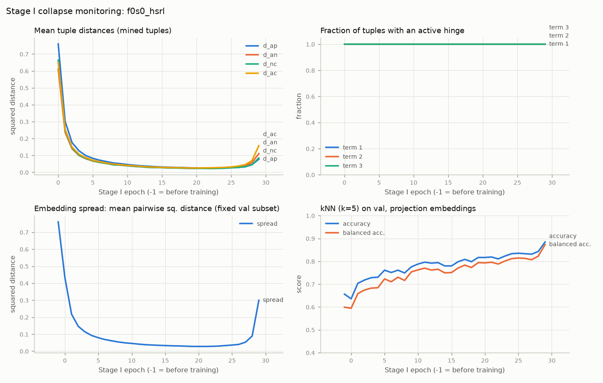
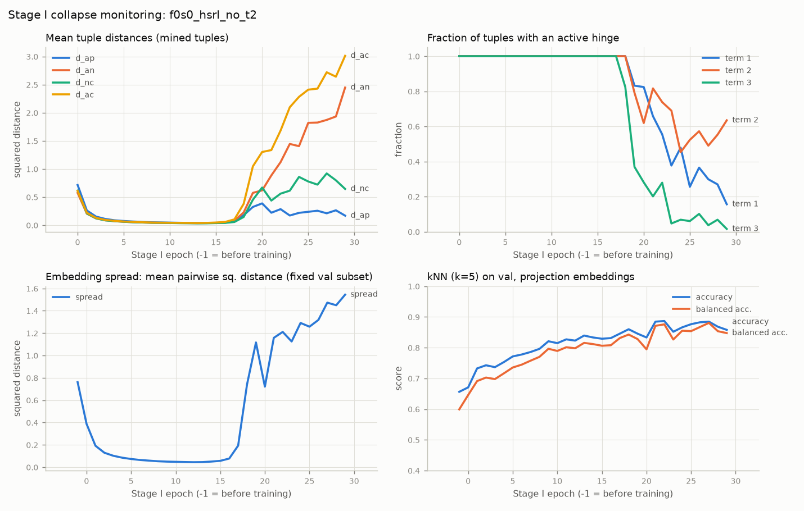

# Fold 0, seed 0: baseline runs

## Test metrics (fold 0 test slides 001 + 003, non-tie patches)

| run | stage | subset | n | acc | bal_acc | macro_f1 | auroc | brier |
|---|---|---|---|---|---|---|---|---|
| f0s0_supervised | supervised | overall | 2857 | 0.7823 | 0.7697 | 0.7692 | 0.8549 | 0.175 |
| f0s0_supervised | supervised | unanimous | 1974 | 0.8399 | 0.8342 | 0.815 | 0.912 | 0.1283 |
| f0s0_supervised | supervised | split_vote | 883 | 0.6535 | 0.6633 | 0.6526 | 0.7461 | 0.2794 |
| f0s0_hsrl | stage2 | overall | 2857 | 0.7903 | 0.7686 | 0.7731 | 0.8596 | 0.1565 |
| f0s0_hsrl | stage2 | unanimous | 1974 | 0.8485 | 0.8225 | 0.818 | 0.9088 | 0.1106 |
| f0s0_hsrl | stage2 | split_vote | 883 | 0.6602 | 0.6745 | 0.6601 | 0.7387 | 0.2592 |
| f0s0_hsrl | stage3 | overall | 2857 | 0.7917 | 0.7573 | 0.7671 | 0.8619 | 0.166 |
| f0s0_hsrl | stage3 | unanimous | 1974 | 0.8647 | 0.8239 | 0.8313 | 0.9182 | 0.1061 |
| f0s0_hsrl | stage3 | split_vote | 883 | 0.6285 | 0.6557 | 0.6273 | 0.7371 | 0.3 |
| f0s0_hsrl_no_t2 | stage2 | overall | 2857 | 0.7854 | 0.7657 | 0.769 | 0.854 | 0.1718 |
| f0s0_hsrl_no_t2 | stage2 | unanimous | 1974 | 0.8404 | 0.8178 | 0.8101 | 0.9015 | 0.127 |
| f0s0_hsrl_no_t2 | stage2 | split_vote | 883 | 0.6625 | 0.6757 | 0.6622 | 0.744 | 0.272 |
| f0s0_hsrl_no_t2 | stage3 | overall | 2857 | 0.7823 | 0.7533 | 0.7604 | 0.8526 | 0.1754 |
| f0s0_hsrl_no_t2 | stage3 | unanimous | 1974 | 0.849 | 0.8202 | 0.8176 | 0.9055 | 0.1214 |
| f0s0_hsrl_no_t2 | stage3 | split_vote | 883 | 0.6331 | 0.6588 | 0.6322 | 0.7383 | 0.2961 |
| f0s0_hsrl_no_stage1 | stage2 | overall | 2857 | 0.7315 | 0.6835 | 0.6905 | 0.8003 | 0.1762 |
| f0s0_hsrl_no_stage1 | stage2 | unanimous | 1974 | 0.8004 | 0.727 | 0.7402 | 0.854 | 0.1359 |
| f0s0_hsrl_no_stage1 | stage2 | split_vote | 883 | 0.5776 | 0.6108 | 0.5731 | 0.6789 | 0.2664 |
| f0s0_hsrl_no_stage1 | stage3 | overall | 2857 | 0.7672 | 0.721 | 0.7314 | 0.841 | 0.1678 |
| f0s0_hsrl_no_stage1 | stage3 | unanimous | 1974 | 0.843 | 0.7804 | 0.7964 | 0.8999 | 0.1142 |
| f0s0_hsrl_no_stage1 | stage3 | split_vote | 883 | 0.598 | 0.6336 | 0.5927 | 0.7098 | 0.2877 |

## Stage III pseudo-labels (precision vs hidden majority labels, non-tie)

| run | round | pool | accepted | coverage | precision | prec_unanimous | n_unanimous | prec_split | n_split | tie_accepted |
|---|---|---|---|---|---|---|---|---|---|---|
| f0s0_hsrl | pseudo_labels_round0 | 4548 | 3216 | 0.7071 | 0.9145 | 0.9506 | 2410 | 0.7939 | 723 | 83 |
| f0s0_hsrl_no_t2 | pseudo_labels_round0 | 4548 | 3593 | 0.79 | 0.8948 | 0.945 | 2620 | 0.7446 | 877 | 96 |
| f0s0_hsrl_no_stage1 | pseudo_labels_round0 | 4548 | 1417 | 0.3116 | 0.9362 | 0.9701 | 1203 | 0.7225 | 191 | 23 |

- f0s0_supervised: wall time 153.6 s, max GPU mem 2.38 GB, data {'labelled': 488, 'labelled_per_class': {'0': 182, '1': 306}, 'unlabelled': 4548, 'val': 840, 'test': 3004}

## Stage I monitoring: f0s0_hsrl

| epoch | mean_d_ap | mean_d_an | mean_d_nc | mean_d_ac | frac_t1_active | frac_t2_active | frac_t3_active | val_spread_sq | val_mean_norm_of_mean | knn5_acc | knn5_bal_acc |
|---|---|---|---|---|---|---|---|---|---|---|---|
| -1.0 | nan | nan | nan | nan | nan | nan | nan | 0.761 | 0.788 | 0.656 | 0.599 |
| 0.0 | 0.76 | 0.611 | 0.664 | 0.65 | 1.0 | 1.0 | 1.0 | 0.433 | 0.886 | 0.636 | 0.594 |
| 1.0 | 0.301 | 0.237 | 0.249 | 0.254 | 1.0 | 1.0 | 1.0 | 0.218 | 0.944 | 0.704 | 0.659 |
| 2.0 | 0.176 | 0.14 | 0.145 | 0.15 | 1.0 | 1.0 | 1.0 | 0.146 | 0.963 | 0.718 | 0.674 |
| 4.0 | 0.099 | 0.08 | 0.083 | 0.086 | 1.0 | 1.0 | 1.0 | 0.093 | 0.977 | 0.73 | 0.684 |
| 9.0 | 0.051 | 0.042 | 0.043 | 0.045 | 1.0 | 1.0 | 1.0 | 0.049 | 0.988 | 0.776 | 0.754 |
| 14.0 | 0.034 | 0.029 | 0.028 | 0.031 | 1.0 | 1.0 | 1.0 | 0.035 | 0.991 | 0.78 | 0.75 |
| 19.0 | 0.027 | 0.024 | 0.023 | 0.026 | 1.0 | 1.0 | 1.0 | 0.028 | 0.993 | 0.817 | 0.794 |
| 24.0 | 0.026 | 0.027 | 0.024 | 0.029 | 1.0 | 1.0 | 1.0 | 0.033 | 0.992 | 0.833 | 0.812 |
| 29.0 | 0.078 | 0.111 | 0.085 | 0.158 | 1.0 | 1.0 | 1.0 | 0.3 | 0.922 | 0.885 | 0.873 |

- f0s0_hsrl: wall time 514.8 s, max GPU mem 2.4 GB, data {'labelled': 488, 'labelled_per_class': {'0': 182, '1': 306}, 'unlabelled': 4548, 'val': 840, 'test': 3004}

## Stage I monitoring: f0s0_hsrl_no_t2

| epoch | mean_d_ap | mean_d_an | mean_d_nc | mean_d_ac | frac_t1_active | frac_t2_active | frac_t3_active | val_spread_sq | val_mean_norm_of_mean | knn5_acc | knn5_bal_acc |
|---|---|---|---|---|---|---|---|---|---|---|---|
| -1.0 | nan | nan | nan | nan | nan | nan | nan | 0.761 | 0.788 | 0.656 | 0.599 |
| 0.0 | 0.715 | 0.573 | 0.616 | 0.61 | 1.0 | 1.0 | 1.0 | 0.388 | 0.898 | 0.671 | 0.646 |
| 1.0 | 0.261 | 0.205 | 0.209 | 0.22 | 1.0 | 1.0 | 1.0 | 0.192 | 0.951 | 0.733 | 0.691 |
| 2.0 | 0.153 | 0.121 | 0.122 | 0.13 | 1.0 | 1.0 | 1.0 | 0.129 | 0.967 | 0.743 | 0.703 |
| 4.0 | 0.087 | 0.071 | 0.072 | 0.077 | 1.0 | 1.0 | 1.0 | 0.085 | 0.979 | 0.753 | 0.716 |
| 9.0 | 0.049 | 0.041 | 0.041 | 0.045 | 1.0 | 1.0 | 1.0 | 0.05 | 0.987 | 0.821 | 0.797 |
| 14.0 | 0.039 | 0.037 | 0.033 | 0.041 | 1.0 | 1.0 | 1.0 | 0.05 | 0.987 | 0.833 | 0.812 |
| 19.0 | 0.324 | 0.575 | 0.452 | 1.047 | 0.832 | 0.791 | 0.369 | 1.116 | 0.665 | 0.846 | 0.828 |
| 24.0 | 0.219 | 1.405 | 0.859 | 2.283 | 0.479 | 0.453 | 0.068 | 1.291 | 0.596 | 0.866 | 0.855 |
| 29.0 | 0.169 | 2.448 | 0.645 | 3.013 | 0.156 | 0.635 | 0.016 | 1.544 | 0.479 | 0.858 | 0.848 |

- f0s0_hsrl_no_t2: wall time 522.6 s, max GPU mem 2.4 GB, data {'labelled': 488, 'labelled_per_class': {'0': 182, '1': 306}, 'unlabelled': 4548, 'val': 840, 'test': 3004}

- f0s0_hsrl_no_stage1: wall time 196.5 s, max GPU mem 2.38 GB, data {'labelled': 488, 'labelled_per_class': {'0': 182, '1': 306}, 'unlabelled': 4548, 'val': 840, 'test': 3004}
